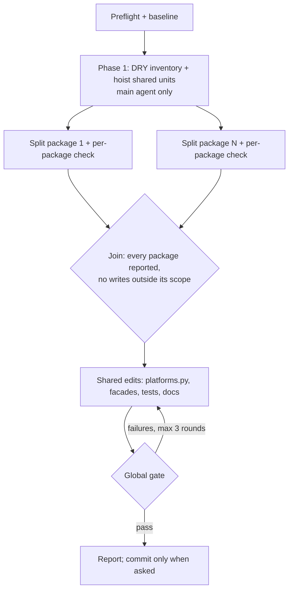

# refactor-backend-god-files

Turn god files into deep, small-file packages. The philosophy: many small cohesive files over one large file. This is a structural move: it never changes behaviour, wire payloads, results, routes or logging. The only public change it may make is an import path, and every such change is a clean-cut break listed in `CHANGELOG.md` (no compat shims, no re-export aliases left behind for old paths).

## Contents

- The workflow graph
- When this applies
- The other axis: placement
- Preflight
- Phase 1: DRY inventory
- Class pattern (Messenger adapters, processors, app classes)
- Module pattern (interfaces, models, functions)
- Reliable split technique
- Optional parallel fan-out
- Join, sweep and test fallout
- Global gate and commits

## The workflow graph



Preflight and Phase 1 are a real chain: shared units must exist before any split consumes them. Without the fan-out the same graph runs sequentially, one package and its check at a time.

## When this applies

- **Size.** A module over ~450 LOC with several responsibilities, or a class whose public and private methods form separable clusters. Target modules under ~250 LOC. Constant tables, a single parser with one job, and generated-looking enum lists may stay big: say so in the report.
- **Placement.** Always, whatever the size (next section).
- **Scaffold drift.** A Platform adapter (`wappa/messaging/<platform>/`, `wappa/webhooks/<platform>/`) whose layout differs from the canonical scaffold in the `wappa-develop` skill (`references/scaffolding.md`). Two Platforms that do the same thing in differently named files is a finding even when every file is small.

## The other axis: placement

Size thresholds are blind to placement. Before splitting, spend one command on the root of the package you are in:

```bash
ls -1 wappa/<package>/*.py
ls -d wappa/<package>/*/
```

- `wappa/` itself holds only `__init__.py` and `platforms.py` (the composition root).
- If a module belongs to one area, it goes in that area's package, whatever its size.
- If two or three modules share a name prefix (`whatsapp_*.py`, `template_*.py`), the prefix is a package name: create the directory and drop the prefix from the file names. Inside `wappa/messaging/whatsapp/`, a `whatsapp_` file prefix is redundant.
- A folder holding one file plus a re-export `__init__.py` is a shallow module: flatten it unless the scaffold says the folder grows.
- Names follow `CONTEXT.md`. Outbound per-action code is not a "handler" (that word is the Host's `WappaEventHandler`), and `utils/`, `services/`, `helpers/` are not domain names: name the module after what it does (`errors.py`, `templates/catalog.py`).

Report placement findings even when asked only about size, and say which axis each finding is on.

## Preflight

1. **Exemplar.** Find a package in this repo already in the target shape and mirror it; a live exemplar beats this file. For Platform adapters the canonical scaffold is `wappa-develop` → `references/scaffolding.md`.
2. **DDD grounding.** Read `CONTEXT.md`, `CONTEXT-MAP.md`, root `ARCHITECTURE.md` (layer dependencies, "Multi-Platform Strategy") and the nearest context `ARCHITECTURE.md` (`wappa/messaging/`, `wappa/webhooks/`, `wappa/api/`) by headings first.
3. **Contract.** Search `docs/public-contract.md` for every module path you will move. A documented path that changes is a break: CHANGELOG Unreleased entry, the migration guide's search list, and `tests/test_public_contract_imports.py`.
4. **Behaviour stays.** If you find yourself changing validation, limits, retries, error codes or wire payloads, stop: that is a separate change with its own tests.
5. **Others' work.** Run `git status --porcelain` and record files you did not change. Never split, stage or commit them; a package someone is reworking is out of scope.
6. **Baseline.** Run the five gates once (`CODING_STANDARDS.md` → "Check gates") and record the pytest pass/fail counts. The global gate compares against them.

## Phase 1: DRY inventory

Splitting alone can cement duplication. Before moving code, inventory cross-cutting duplicates and unify them on the main agent, once:

- **Meta transport and outcomes.** Error-to-`MessageResult` mapping, Graph error parsing, rate-limit handling and retry wording that both Meta Platforms repeat belong in `wappa/messaging/meta/`. Platform-only codes (WhatsApp address rejection, Instagram `10/2534022`) stay in the Platform's `errors.py`.
- **Neutral values.** A value both Platforms use (limits, enums, result helpers, `_Parts`-style aggregators) lives in `wappa/domain/`, never in one Platform's folder.
- **Duplicate vocabularies.** Two enums with the same members (a Template media type defined twice, three media-type enums) collapse to one home.

Rule of three: promote only what appears three or more times across two or more packages; one-offs stay local. A new base class every adapter must inherit is an ADR-worthy decision: propose it, don't introduce it silently. Output the inventory (duplicate → target unit → call sites) and land it before any split, so every new module consumes the shared unit.

## Class pattern (Messenger adapters, processors, app classes)

Convert `messenger.py` holding one big class into a package named for the stem, `messenger/`:

- `__init__.py` re-exports the class and any module symbol tests or callers import, with `__all__`.
- `adapter.py` holds the composed class: `__init__`, capabilities, `supported_operations`, and the stateful helpers the mixins call through `self` (delivery, result assembly).
- One mixin module per operation family, matching ADR-0016's one method per action: `text.py` (`_TextMixin`), `media.py`, `interactive.py`, `specialized.py`, `receipts.py`, `profile.py`, and `templates.py` where the Platform has Templates.
- Pure builders with no `self` and no I/O go to `payloads/` modules, not mixins.
- **Carry the original bases.** List existing base classes after the mixins (`class InstagramMessengerAdapter(_TextMixin, _MediaMixin, IMessenger)`) so `super().__init__` and ABC checks still work. A dropped `IMessenger` base passes ruff and fails at runtime or in `tests/test_messenger_parity.py`.
- **Preserve invariants.** Every send still goes through the same delivery path (WhatsApp's address fallback, Instagram's multi-part `wappa_parts`), the same rate-limit governor and the same logging. Splitting reads and writes is where these silently break.

The same shape fits a processor (`processor/` with one module per webhook lane) and an app or builder class (mixins per lifecycle cluster).

## Module pattern (interfaces, models, functions)

A file of several independent ABCs or model families (`cache_interfaces.py`, `universal_webhooks.py`, a Platform's wire `models.py`) becomes a package named for the stem, one module per family (`cache_interfaces/user.py`, `state.py`, `table.py`, ...), with `__init__.py` re-exporting the public names so the dotted path keeps working. Values and errors used by one family move with it.

## Reliable split technique

Slice each method or function's line range into its new file, seed every new file with the old file's full import block, then `uv run ruff check --fix <dir>`: F401 prunes each file to what it uses and I sorts. Keep function-local (deferred) imports where they were; they are often deliberate cycle-breakers. Add `git mv` for a pure rename so history follows. Delete the old file last.

**Per-package check, before starting the next:** `uv run ruff check <pkg>`, `uv run mypy <pkg>`, and an import of the moved surface at its path (`uv run python -c "from wappa.messaging.instagram import InstagramMessenger"`). Sequentially, also run that package's tests (`uv run pytest -q tests/test_instagram_*.py`).

## Optional parallel fan-out

For a multi-package rollout, dispatch one general-purpose agent per package in one message. It is collision-free only with these rules:

- **Shared files stay on the main agent:** `wappa/platforms.py`, `wappa/__init__.py`, `wappa/messaging/__init__.py` and other public facades, `wappa/messaging/meta/`, `wappa/domain/`, everything under `tests/` and `docs/`, the context docs and the shipped skills. A worker that needs one of those edits reports it.
- **Disjoint scope:** each worker edits only its package folder. Stem-preserving packages mean no worker edits another package's importers.
- **One brief:** this file's rules, the exemplar path, the Phase 1 units it must consume, its exact targets, and the return contract (files created and deleted, symbols kept at their paths, its per-package check output, shared edits it needs). Workers see neither this conversation nor each other.
- **Verification override:** workers share one tree, so they run only their per-package check, never `pytest` or `ruff check .` mid-flight. Use `isolation: "worktree"` instead when a worker must run the suite.

## Join, sweep and test fallout

At the join, check every worker reported and passed, then `git status --porcelain`: every changed path must sit in the reporting package or be listed in the preflight record. A package that failed or never reported is redone on the main agent, sequentially.

Then sweep: normalize divergent signatures across sibling packages (two adapters split into differently named mixins is new scaffold drift), and AST-scan for parameters that became unused, since ruff's default rules don't flag them.

Test fallout, fixing wiring and never assertions: a `monkeypatch.setattr("wappa.x.y.Name", ...)` or `patch("wappa.x.y...")` must follow the symbol to the module where it is resolved now (the mixin module that imports it), a test that reads source by path globs the package, and a call to a promoted private helper calls the new module function. A patch on the wrong module is a silent false green: check the patched test still asserts behaviour.

## Global gate and commits

1. The five gates from `CODING_STANDARDS.md`, compared against the baseline; `tests/test_doc_claims.py`, `tests/test_public_contract_imports.py`, `tests/test_third_platform_contract.py` and `tests/test_shipped_skills.py` must be green.
2. Docs in the same change: the context `ARCHITECTURE.md` trees and change chains, `docs/public-contract.md`, `CHANGELOG.md` breaks, `wappa-develop` → `references/scaffolding.md`, and any shipped skill that names a moved path.
3. Fix loop capped at three rounds; at the cap, report what still fails per package. Never make a round pass by editing an assertion or weakening a check.

Never auto-commit. When asked: one commit per package, `[MOD] [<SCOPE>] Split <module> into a <package>/ package` (scope as in `CODING_STANDARDS.md`, for example `WHATSAPP`, `INSTAGRAM`, `CORE`), shared hoists and test wiring in their own commits, and only your own files staged.
