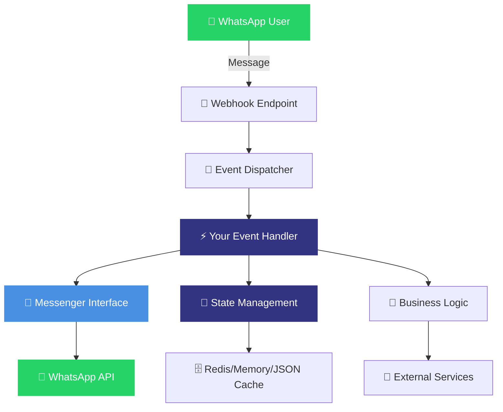

# Wappa 🤖

**Open Source Framework for WhatsApp Business Applications**

Build intelligent WhatsApp bots, workflows, and chat applications with clean architecture and modern Python.

[](https://www.python.org/downloads/)
[](https://opensource.org/licenses/Apache-2.0)
[](https://fastapi.tiangolo.com)
[](https://developers.facebook.com/docs/whatsapp)
[](CHANGELOG.md)

> **v0.32.0 — FastAPI compatibility and router authentication** — Wappa uses FastAPI 0.162.x, keeps public router exemptions within their mounted prefixes, and simplifies cron route registration. See [CHANGELOG.md](CHANGELOG.md).

---

## 🚀 What is Wappa?

Wappa is a modern Python framework that transforms WhatsApp Business API into a powerful platform for building:

- **🤖 Smart Chatbots** - AI-powered conversational experiences
- **📋 Workflows** - Multi-step business processes  
- **🎯 Agents** - Intelligent customer service automation
- **💬 Chat Applications** - Full-featured messaging platforms

**Built for developers who want clean code, not webhook complexity.**

## ✨ Key Features

### 🎯 **Simple & Clean**
```python
from wappa import Wappa, WappaEventHandler
from wappa.messaging import DirectMessage

class MyBot(WappaEventHandler):
    async def process_message(self, webhook):
        await self.messenger.send_text(
            "Hello!",
            DirectMessage(
                inbox_ref=self.inbox_ref,
                addresses=webhook.user.delivery_addresses(),
            ),
        )

app = Wappa()
app.set_event_handler(MyBot())
app.run()
```

### 🏗️ **Production-Ready Architecture**
- **Clean Architecture** - Domain-driven design with dependency injection
- **Type-Safe** - Full Pydantic models for all WhatsApp data structures
- **Multi-Inbox** - Built for scaling across multiple business numbers
- **Plugin System** - Extensible with Redis, CORS, rate limiting, and custom plugins

### 📱 **Complete WhatsApp Support**
- **All Message Types** - Text, media, interactive buttons, lists, templates
- **Rich Interactions** - Buttons, lists, call-to-action messages
- **Media Handling** - Images, videos, audio, documents with automatic upload/download
- **Templates** - Pre-approved business message templates through the `ITemplateMessaging` capability

### 🆔 **Message Targets and BSUID Support**
- **Explicit Targets** - Every `self.messenger.send_*` call takes a `target`; there is no `recipient` keyword and bare strings are rejected. `send_text` also accepts a `PrivateReply` (Instagram).
- **DirectMessage** - `DirectMessage(inbox_ref=..., addresses=...)` binds a User's Delivery Addresses to the Inbox allowed to use them. In a handler, use `self.inbox_ref` and `webhook.user.delivery_addresses()`; outside webhooks, use `DeliveryAddresses.of(*known)`. A target for a different Inbox fails before any send.
- **BSUID-Aware Fallback** - The WhatsApp adapter tries the phone number first, then the BSUID, and moves to the next address only when Meta rejects the address itself (`131030`, or `131062` when a message type cannot go to a BSUID). Authentication Templates go to phone numbers only.
- **No Blind Retries** - Window, rate-limit, content and timeout errors are returned as-is, never retried on another address. `MessageResult.attempted_recipients` lists the addresses tried after a fallback.

See `docs/public-contract.md` and ADR-0022 for the full contract.

### 🛠️ **Developer Experience**
```bash
# Initialize new project
wappa init my-bot

# Start development server with auto-reload
wappa dev app/main.py

# Browse interactive examples
wappa examples
```

### 💾 **Flexible State Management**
```python
# Memory, JSON file, or Redis caching
app = Wappa(cache="redis")  # or "memory" or "json"

# Automatic state persistence
await self.state_cache.set("conversation", {"step": "greeting"})
```

### Inbox-scoped Template transport

Embedding applications send Templates through Wappa's public runtime capability;
they do not construct WhatsApp clients, handlers, sessions, or pipelines:

```python
from wappa import InboxRef
from wappa.messaging import (
    OutboundRuntime,
    PhoneNumberTemplateRecipient,
    TextTemplateTransportRequest,
)

transport = OutboundRuntime.from_app(fastapi_app).templates(
    InboxRef.whatsapp(phone_number_id)
)
result = await transport.send(
    TextTemplateTransportRequest(
        recipient=PhoneNumberTemplateRecipient(value="573001112233"),
        template_name="welcome",
        category="utility",
    )
)
```

`result.outcome` is `accepted`, `rejected`, `transport_unavailable`, or
`indeterminate`. Acceptance proves a platform Message ID, not delivery or a Host
Application commit. Wappa's standalone Template HTTP routes are opt-in with
`Wappa(include_template_transport_api=True)`.

An embedding application that owns its own authenticated boundary drops Wappa's
unauthenticated mutation surface with one argument:

```python
app = Wappa(cache="redis", route_profile="embedded")
```

That omits every route which sends a message, deletes a media asset, or
rewrites a recipient's cached state. Media upload/download/lookup, limits,
validation, Template info, webhooks, health, and every `wappa.messaging`
service stay exactly as they are. Standalone applications need no change.

## 📦 Installation

### Using uv (Recommended)
```bash
# Create new project
uv init my-wappa-project
cd my-wappa-project

# Add Wappa
uv add wappa

# Initialize project structure
wappa init .
```

### Using pip
```bash
pip install wappa

# Initialize new project
wappa init my-wappa-project
cd my-wappa-project
```

`wappa init` also adds Wappa's agent skills under `.claude/skills/` and `.agents/skills/`, so coding agents build against the current public API: `wappa-apps` (WhatsApp and Instagram apps from one handler, media formats, connecting accounts, Meta setup), `wappa-conversational-scores` (Scores and guided forms), `wappa-state-and-storage` (caches, Redis, Postgres), `wappa-scheduled-tasks` (reminders, timers, recurring jobs and heartbeats on one hook) and `wappa-host-integration` (multi-Inbox, plugins, external webhooks, crons, upgrades). Existing skill folders are never overwritten.

### Using Poetry
```bash
poetry new my-wappa-project
cd my-wappa-project
poetry add wappa

# Initialize project structure  
wappa init .
```

## 🏃‍♂️ Quick Start

### 1. Get WhatsApp Business API Credentials

1. Visit [Meta for Developers](https://developers.facebook.com)
2. Create a WhatsApp Business App
3. Get your credentials:
   - **App Secret** (`META_APP_SECRET`) — Wappa verifies every webhook POST body with it; there is no development bypass
   - A verify token you choose (`META_WEBHOOK_VERIFY_TOKEN`) — used only for Meta's GET challenge
   - **Access Token**, **Phone Number ID**, **Business Account ID** (`META_WHATSAPP_ACCESS_TOKEN`, `META_WHATSAPP_PHONE_NUMBER_ID`, `META_WHATSAPP_BUSINESS_ACCOUNT_ID`) — the legacy single-Inbox bundle
4. Configure the one callback URL in the Meta App: `https://<host>/webhook/inboxes/whatsapp`

### 2. Create Your Bot

```bash
# Initialize project
wappa init my-bot
cd my-bot

# The generated project already contains .env
# Edit .env with your credentials
```

### 3. Run Development Server

```bash
# Start with auto-reload
wappa dev app/main.py

# Or manually
uv run python -m app.main
```

### 4. Test Your Bot

Send a message to your WhatsApp Business number and watch it echo back!

### Many Inboxes under one Meta App (explicit mode)

Wappa has exactly two Inbox Routing Modes and they never mix. `legacy` (the default) runs the single Inbox from the `META_WHATSAPP_*` bundle. `explicit` runs any number of Inboxes through Wappa's encrypted Inbox Directory: you implement a read-only `IInboxDirectorySource` over your own database, Wappa owns encryption (`SYSTEM_TOKEN_ENC_KEY`), caching, the WABA reverse index, and Messenger eviction.

Start a Host-adapter scaffold with `wappa init my-bot --inbox-routing explicit`.
It includes the required environment configuration and an
`IInboxDirectorySource` stub to connect to the Host's durable Inbox records.

```bash
# Explicit mode never mixes with the legacy META_WHATSAPP_* Inbox bundle.
SYSTEM_INBOX_ROUTING_MODE=explicit
SYSTEM_TOKEN_ENC_KEY=<Fernet key from CredentialCodec.generate_key()>
```

```python
from wappa import Wappa, InboxRoutingMode

app = Wappa(
    cache="redis",
    inbox_routing=InboxRoutingMode.EXPLICIT,
    inbox_directory_source=MyInboxSource(db),   # implements IInboxDirectorySource
)
```

Explicit mode rejects `META_WHATSAPP_ACCESS_TOKEN`, `META_WHATSAPP_PHONE_NUMBER_ID`, and `META_WHATSAPP_BUSINESS_ACCOUNT_ID` at startup, and every Inbox-dependent `/api/whatsapp/*` call sends `X-Wappa-Inbox-ID` — a selector, not a credential; your authentication decides who may use it. The ordered setup, the credential commands, and the key-rotation runbook are in [docs/migration/v0.27.0-multi-inbox.md](docs/migration/v0.27.0-multi-inbox.md).

## 🎛️ Architecture Overview



- **Event-Driven**: Webhook → Event Handler → Response
- **Type-Safe**: Full Pydantic models for all WhatsApp data structures  
- **FastAPI Core**: Built on modern async Python with automatic OpenAPI docs
- **Production Ready**: Docker support, Redis caching, structured logging

## 📚 Documentation

**📖 [Complete Documentation](https://wappa.mimeia.com/docs)**

### Quick Links

- **🚀 [Quick Start](https://wappa.mimeia.com/docs/getting-started)** - Get running in 5 minutes
- **🏗️ [Architecture Guide](https://wappa.mimeia.com/docs/concepts/architecture)** - Understanding the framework
- **📡 [API Reference](https://wappa.mimeia.com/docs/api/messaging)** - Complete messaging API
- **💾 [State Management](https://wappa.mimeia.com/docs/concepts/state-management)** - Caching and persistence
- **🚀 [Deploy to Railway](https://wappa.mimeia.com/docs/deployment/railway)** - Production deployment
- **🛠️ [WhatsApp Setup](https://wappa.mimeia.com/docs/setup/whatsapp-setup)** - Configure WhatsApp Business API

### Example Projects

Explore 9 complete example applications:

```bash
# Browse examples interactively
wappa examples

# Pick an example from the menu and copy it into ./my-bot/
wappa examples my-bot
```

- **Basic Project** - Minimal Wappa project with basic message handling
- **Simple Echo Bot** - Echoes all incoming messages with acknowledgment
- **Expiry Actions Demo** - Inactivity detection with message accumulation using ExpiryActions
- **JSON Cache Demo** - File-based caching with user management and state handling
- **Redis Cache Demo** - Redis-powered caching with advanced state management
- **OpenAI Transcription** - Voice message transcription using OpenAI Whisper API
- **Redis PubSub Plugin** - Multi-inbox Redis PubSub with self-subscribing pattern
- **DB + Redis Cache** - PostgreSQL + Redis two-tier storage with SOLID architecture
- **Full-Featured Bot** - Complete WhatsApp bot with all features and deployment configs

## 🛠️ Advanced Usage

### Builder Pattern for Complex Apps

```python
from wappa import Wappa, WappaBuilder
from wappa.core.plugins import CORSPlugin, RateLimitPlugin, RateLimitProfile, RedisPlugin

fastapi_app = (
    WappaBuilder()
    .with_inbox_routing("explicit")
    .with_inbox_directory_source(MyInboxSource(db))
    .add_plugin(RedisPlugin())
    .add_plugin(CORSPlugin(allow_origins=["*"]))
    .add_plugin(RateLimitPlugin([RateLimitProfile(name="default", limit=100, window_seconds=60)]))
    .configure(title="My Wappa App")
    .build()
)

app = Wappa()
app.set_app(fastapi_app)
app.set_event_handler(MyAdvancedHandler())
app.run()
```

### Plugin System

```python
from wappa import Wappa
from wappa.core.plugins import CORSPlugin, PostgresDatabasePlugin

app = Wappa(cache="redis")
app.add_plugin(PostgresDatabasePlugin("postgresql://..."))
app.add_plugin(CORSPlugin(allow_origins=["*"]))
app.set_event_handler(MyHandler())
app.run()
```

### CLI Commands

```bash
# Project management
wappa init [directory]          # Initialize new project
wappa examples [directory]      # Pick an example and copy it to directory

# Development
wappa dev app/main.py           # Development server with auto-reload
wappa prod app/main.py          # Production server

# Help
wappa --help                    # Show all commands
```

## 🚀 Deployment

### Railway (Recommended)

```bash
# Install Railway CLI
npm install -g @railway/cli

# Login and deploy
railway login
railway init
railway add redis
railway up

# Set environment variables (legacy single-Inbox mode)
railway variables set META_APP_SECRET=your_meta_app_secret
railway variables set META_WEBHOOK_VERIFY_TOKEN=your_verify_token
railway variables set META_WHATSAPP_ACCESS_TOKEN=your_token
railway variables set META_WHATSAPP_PHONE_NUMBER_ID=your_phone_id
railway variables set META_WHATSAPP_BUSINESS_ACCOUNT_ID=your_business_id
```

See [complete Railway deployment guide](https://wappa.mimeia.com/docs/deployment/railway).

### Docker

```dockerfile
FROM python:3.12-slim

WORKDIR /app
COPY . .

RUN pip install uv
RUN uv sync --frozen

EXPOSE 8000
CMD ["uv", "run", "python", "-m", "app.main"]
```

## 🧪 Development

### Setup Development Environment

```bash
# Clone repository
git clone https://github.com/sashanclrp/wappa.git
cd wappa

# Install dependencies
uv sync --group dev

# Run tests
uv run pytest

# Code formatting
uv run ruff check .
uv run ruff format .
```

### Project Structure

```
wappa/
├── wappa/                  # Core framework
│   ├── core/              # Application core & plugins
│   ├── messaging/         # WhatsApp messaging implementation
│   ├── persistence/       # Cache backends (Memory/JSON/Redis)
│   ├── cli/               # CLI tools, project templates & examples/
│   └── api/               # FastAPI routes & dependencies
├── docs/                  # Documentation source
└── tests/                # Test suite
```

## 🤝 Community & Support

### 💬 **Join the Community**
- **💭 [Discord Community](https://discord.gg/wappa)** - Get help, share projects, and connect with other developers
- **🐛 [GitHub Issues](https://github.com/sashanclrp/wappa/issues)** - Bug reports and feature requests
- **📖 [GitHub Discussions](https://github.com/sashanclrp/wappa/discussions)** - Questions and community discussions

### 📞 **Get Support**
- **📚 [Documentation](https://wappa.mimeia.com/docs)** - Comprehensive guides and API reference
- **💡 [Examples](https://wappa.mimeia.com/docs/resources/examples)** - 9 complete working examples
- **🔧 [Configuration Guide](https://wappa.mimeia.com/docs/setup/whatsapp-setup)** - WhatsApp Business API setup

### 🤝 **Contributing**
We welcome contributions! Please see our [Contributing Guide](CONTRIBUTING.md) for details.

- **🐛 Found a bug?** Open an [issue](https://github.com/sashanclrp/wappa/issues)
- **💡 Have an idea?** Start a [discussion](https://github.com/sashanclrp/wappa/discussions)
- **🔧 Want to contribute?** Check out [good first issues](https://github.com/sashanclrp/wappa/labels/good%20first%20issue)

## 📋 Requirements

- **Python 3.12+** - Modern Python with latest type hints
- **WhatsApp Business API** - Meta for Developers account
- **Redis** (optional) - For production caching and state management

## 📄 License

This project is licensed under the Apache License 2.0 - see the [LICENSE](LICENSE) file for details.

## 🙏 Acknowledgments

- **Meta** - For the WhatsApp Business API
- **FastAPI** - For the excellent async Python framework
- **Redis** - For high-performance caching
- **Open Source Community** - For inspiration and contributions

---

**Built with ❤️ by [Mimeia](https://mimeia.com) • Open Source • Apache 2.0 License**

*Transform your business communication with WhatsApp automation.*

### Instagram text (Unified Login)

Wappa has an Instagram adapter for DMs, comments and mentions. Use explicit Inbox routing and an encrypted Instagram credential record through IInboxDirectorySource. The callback is `/webhook/inboxes/instagram`; Meta signature authentication remains mandatory. Recipient-based Messenger sends use Inbox-qualified DirectMessage targets, including on WhatsApp. The same Messenger methods (`send_button_message`, `send_list_message`, `send_carousel`, `send_location`, `send_contact`, `mark_as_read`, ...) work on both Platforms, and a User's choice always arrives in `process_message` via `get_interactive_selection()` ([ADR-0025](docs/adr/0025-messenger-contract.md)). Media upload and download go through the shared `IMediaLibrary` capability; comment actions (`ICommentControls`) and WhatsApp Templates (`ITemplateMessaging`) are capability-gated too.

See the [setup walkthrough](docs/backlog/in_progress/261103-instagram-conversations/references/setup.md) and
[public contract](docs/public-contract.md#instagram-conversations-contract)
for startup, addressing migration, and capability boundaries. Live receipt still
requires an authorized account, subscriptions, and appropriate Meta app access.

The [Instagram implementation PRD series](docs/backlog/in_progress/261103-instagram-conversations/plan.md)
tracks the remaining message/public-conversation capabilities, Unified Login,
Symphonai integration, DDD updates and developer skill packages. Its planned
capabilities and skills are not all available in the current adapter.
