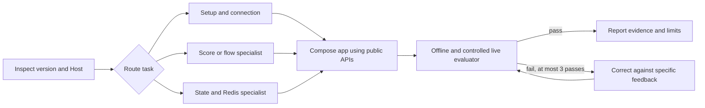

# Developer skills, Meta setup reference and distribution

## Context

The user explicitly requested `skills-engineering` to make app-building guidance
reusable. This PRD defines actual skill deliverables, not merely a long Instagram
tutorial. Read the [series](../plan.md),
[completed grilling session](../../../../sasha/grilling-sessions/261103-instagram-scope-and-extensions.md),
[setup evidence](../references/setup.md) and
[test learnings](../tests/simple-text-test.md).
Skill authoring/evaluation is later implementation work; this file is its design.

`skills-engineering` was applied in design mode: identify task nodes and real
dependencies, use a small router with lazy references, deterministic checks and
a bounded evaluator loop. Follow its skill-authoring, presentation and staleness
references when producing the packages. Do not make runtime API examples valid
only in the author's checkout or pretend proposed APIs already ship.

## Existing skills and reuse evidence

Inspected local sources on 2026-11-03. `Symphonai checkout` means a separately
discovered repo root; do not hardcode an absolute filesystem path in a shipped skill.

| Existing skill/reference | Observed source | Reuse boundary |
| --- | --- | --- |
| `develop-wappa` | Symphonai `.agents/skills/develop-wappa/SKILL.md`, `references/caches.md`, `messenger-pipeline.md`, `public-imports.md`, `env-vars.md` | Host integration, identity/credentials and cache-scope reference. Existing version-specific descriptions must be reconciled with the implemented Instagram contract. |
| `symphonai-add-score` | Symphonai `backend/symphonai/scaffolding/templates/root/skills/symphonai-add-score.md.tmpl` and eval template | Per-message host Score chain, predicates, priorities and stop/pass semantics; not a universal Wappa registry. |
| `symphonai-add-state-handler` | Same template root, `symphonai-add-state-handler/SKILL.md.tmpl` and conversational-form/testing references | Guided multi-turn Symphonai flows; delegate instead of reimplementing host StateHandlers. |
| `develop-symphonai-package` | Symphonai `.agents/skills/develop-symphonai-package/SKILL.md` | Optional host package, publication/analytics tooling and extension ownership. |
| `skills-engineering` | Installed authoring skill | Lint, workflow graph, discovery, progressive disclosure, evals and lane parity for this collection. It is an authoring dependency, not required for normal app execution. |

Baseline mechanical lint of the inspected `develop-wappa` package returned
0 errors / 0 warnings. This does not certify its semantic compatibility: its
v0.33 host contract predates the selected extension seam, and Score teaching
currently includes `recipient=` examples needing migration. Existing template
skills are not assumed installed in every developer's harness.

## Scope and proposed collection

| Machine skill name | Human title | Owns | Explicit handoff |
| --- | --- | --- | --- |
| `wappa-instagram-apps` | Instagram apps with Wappa | Entry/router: scaffold or extend a conversational app; connection/setup; selected capability branches; validate offline and live evidence. | Reusable score/flow logic → `wappa-conversational-scores`; state/Redis → `wappa-runtime-state`; detect Symphonai and route to its installed specialist skills. |
| `wappa-conversational-scores` | Wappa conversational handlers | Plain-Wappa application Score/handler composition, DI, message/action predicates and host-owned flow examples. | Symphonai app → `symphonai-add-score` or `symphonai-add-state-handler`; transport/setup → parent skill; cache semantics → `wappa-runtime-state`. |
| `wappa-runtime-state` | Wappa state and Redis | Context-bound User/State/Expiry/AI caches, Table Cache context, TTL/miss/failure behavior and concurrent state validation. | Symphonai-owned read models/persistence → installed `develop-wappa`/host domain guidance, not a generic runtime Table Cache handed to Tools. |

These are planned new generic Wappa skills; the existing Symphonai skills keep
their names and ownership. Discover skills by name through the current harness,
then read the actual installed source. Optional host-specific skills are invoked
only in a matching Host. If absent, name the missing specialist and its canonical
source, and use the generic supported path where applicable; do not invent a
path, silently install a package, or make plain Wappa require Symphonai.

## Scope-specific references

The main Instagram SKILL.md links every bundled reference directly (one level):

- `references/meta-app-setup.md`: the exact Meta use-case setup below.
- `references/text-and-media.md`: implemented operation/target matrix, native
  media lookup/bytes, limitations and uncertainty; no secret URL forwarding.
- `references/interactions-and-comments.md`: typed selections, comment source
  filtering, explicit public/private reply visibility, control primitives and
  consumer policy ownership. Split if needed to stay concise.
- `references/unified-login-and-extensions.md`: account discovery, required/optional
  grants, encrypted persistence, current-credential access and field registration.
- `references/testing-and-troubleshooting.md`: sanitized evidence, known setup
  failures and gates; distinguish GET, signed intake, provider acceptance and READ.
- `references/skill-routing.md`: installed skill discovery, generic versus
  Symphonai boundary, handoff inputs/outputs and missing-specialist behavior.

The Score and state skills directly link their own focused references and the
other skills by name. No copy of the entire Symphonai skill tree. Keep Score as
application terminology: do not teach `from wappa import ScoreBase` or a generic
registry unless that public contract actually exists. Plain-Wappa examples may
use their own injected `ScoreBase` pattern; Symphonai has its own exported API.

## Setup reference requirements

Use the recorded walkthrough as evidence, then reconcile it into a canonical
developer guide plus the portable bundled reference. Document the real sequence:

1. In an existing Meta app with WhatsApp, add **Manage messaging & content on
   Instagram**. Distinguish it from Facebook Page Messenger. Follow the chosen
   **Unified Login** setup, not mixed legacy credentials/hosts.
2. Create/select a compatible login configuration. Record login variation,
   authorized assets, token kind and selected permissions without treating all
   dashboard-template permissions as requirements of every conversation feature.
3. Register the actual consumer's OAuth redirect, distinct from the webhook.
   Never reuse a stale WhatsApp redirect/tunnel and claim IG login works.
4. For controlled testing, document professional-account eligibility, Instagram
   Tester invite/acceptance and account access. Preserve the observed failure
   “select a configuration in Step 1” and its resolution. Distinguish this test
   path from full independent-customer OAuth onboarding.
5. Start the real app with supported `wappa` CLI commands and expose its HTTPS
   endpoint. Configure `/webhook/inboxes/instagram` separately from WhatsApp.
   `WP_WEBHOOK_VERIFY_TOKEN` is currently the shared GET value; `META_APP_SECRET`
   authenticates POST bytes. Do not invent `IG_WEBHOOK_VERIFY_TOKEN`.
6. Verify GET challenge; select only required app-level fields; subscribe the
   authorized professional account. A stored credential or GET 200 alone does
   not prove account subscription, signed delivery or a working reply.
7. Validate actual text echo, echo-loop prevention and seen event. Expand to
   media/interactions/comments only after their capability slice exists. Use
   the recorded single-User/sequential tests without claiming concurrency proof.
8. Test full self-service login, optional consent, reconnect and revocation once
   I06 is implemented. Teach no manual customer token copying as the production path.

External console/API reference files carry `checked_on`, `checked_against` and
`revision` frontmatter based on an actual review, with primary Meta source links
and the tested API version. Never stamp an unperformed verification. The consuming
skill compares the live console/docs when labels/fields differ or the review is
old, reports drift, and trusts verified current behavior over stale screenshots.
Retain the `message_edit` documentation discrepancy until resolved. Use placeholders
for IDs/URLs and never copy tokens, app secrets, query verify tokens or authorization
codes into references, screenshots, evals or example env files.

## Workflow graph and node contracts

| Node | Consumes | Produces | Executor |
| --- | --- | --- | --- |
| Inspect | User request, installed Wappa/Host, public contract and available skills | Version/capability/Host inventory | Agent + deterministic import/CLI checks |
| Route | Inventory and intended outcome | One task branch and specialist/reference set | Agent |
| Setup | Verified Meta setup + app config | Endpoint/subscription/connection evidence or explicit missing prerequisite | Developer + package helpers |
| Build | Implemented capability, relevant specialist output and consumer policy | Reviewable app/flow/extension code | Agent/developer |
| Verify | App artifact and independent expected behavior | Offline receipts and controlled live evidence | Tests + developer/provider observations |
| Correct | Specific failing evidence | Bounded revision or concrete unresolved finding | Agent, at most three passes |

Only selected branches run. Setup is not required for a read-only code review;
a memory-only echo does not load Redis details; Score/state specialists do not
depend on a completed live login to produce offline code. Live proof requires
the real connection and implemented capability. Shared schema changes precede
app examples; they are not falsely parallel. At the evaluation cap report the
remaining finding, never label the application ready.

## Distribution and lane design

Ship the three skills as package data, canonically under a Wappa CLI-owned
skill collection (proposed `wappa/cli/skills/<name>/`). Root `.agents/skills`
and `.claude/skills` expose the same canonical content through relative symlinks.
`wappa init` and relevant copied examples emit a portable collection and both
discovery lanes, without depending on this checkout or a new undocumented CLI
command. Where symlinks are unavailable, emit identical files and test parity.
Existing user-owned skill files are never silently overwritten; report conflicts
through the current scaffold behavior with a reviewable resolution.

Each package includes SKILL.md, directly linked references, `agents/openai.yaml`
and evals. Provide clear display_name, 25–64-character short_description and
default_prompt naming the exact skill; preserve unrelated policy/dependency
metadata. Third-person descriptions state real trigger terms and exclusions;
body stays under 500 lines. References over 100 lines have a contents list.
Skill-local resources use relative paths, cross-skill references use names,
not `.agents`/`.claude` or a personal filesystem path. Inspect packaged and
generated copies, not only root symlinks.

## Evals before authoring

Write at least three behavioral evals per new skill before producing its body.
Use deterministic assertions for imports, target signatures, graph links and
namespace behavior; assess app outputs against explicit independent expectations.

| Skill | Required positive and failure scenarios |
| --- | --- |
| `wappa-instagram-apps` | Fresh plain-Wappa text app routes to correct public imports; Meta setup separates GET/OAuth/subscriptions and resolves missing configuration; shared-caption/public mention/PrivateReply does not silently become an ordinary DM; unsupported reaction request is excluded. |
| `wappa-conversational-scores` | Plain-Wappa handler composes injected Score logic without importing a nonexistent core registry; Symphonai request routes to its actual Score/StateHandler skill; repeated/stale selection and cancellation remain consumer policy with correct action payload. |
| `wappa-runtime-state` | Two Users and two Platforms/Inboxes with colliding native strings remain isolated; TTL/miss/outage behavior is explicit with no hand-built keys; Host business records/credentials are not placed in generic workflow cache or exposed to Tools. |

Add routing negative tests: ordinary WhatsApp Template work must not invoke an
Instagram-specific flow; Redis-only review need not open Meta setup; generic
Wappa must work when all Symphonai specialist skills are unavailable. Add a
compositional eval building a complete interactive Instagram intake from the
router and specialist handoffs. Use no paid sends or destructive real calls in
offline evals. Live actions follow explicit controlled test intent and actual
available account access, not invented automation of the Meta console.

## Exit criteria and validation

- Follow `skills-engineering`: evals before edits; normal and professional lint
  on all three authored skills; zero errors, warnings fixed or justified; at
  most three revision rounds. The invoked skill supplies the linter path;
  do not assume a user's global install location.
- Run its `scripts/lint_skill.py <skill-dir>`, `--professional <skill-dir>` and
  `--lanes <repo-or-generated-root>` modes on the relevant artifacts. Fix new
  lane errors; report pre-existing unrelated drift without overwriting it.
- Independent fresh-agent task evaluation on each supported harness/model for
  this shipped collection, plus trigger/negative/compositional evals. Record
  environment, output/evaluator evidence and any unrun live/picker checks.
- Verify `agents/openai.yaml` mechanically and the actual picker when available;
  absence of picker access is reported, not counted as visual verification.
- Disposable `wappa init`/example generation and a built-wheel install discover
  the collection, resolve references/handoffs and run generated code using the
  implemented public contract. No absolute checkout dependency or secret leaks.
- Canonical setup guide and bundled reference agree with the observed Meta app
  setup, current config and gate-B flow. External reference stamps are real.
- Update root README, CLI architecture/public scaffold contract and relevant
  Symphonai skill/template sources. Never copy old `recipient=` examples into
  new target-based guidance or advertise planned operations as implemented.
- Collection passes generic Wappa and optional Symphonai branches, including
  missing-specialist handling, DI/SRP and cache/identity boundaries.

## Out of scope and open verification

No business flow engine, AI prompt library, publishing/analytics implementation,
new generic Score core API, automatic global skill installation or rewrite of
unrelated installed skills. Discover actual current specialist names before
authoring; existing sources may move. Exact skill packaging helpers must fit
the current CLI; public distribution is not complete until the wheel and
generated app tests prove it.
