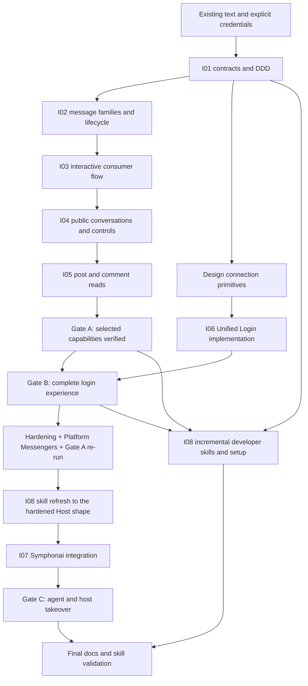

# Instagram conversations, connection lifecycle and developer skills

## Context

This is the executable PRD series for finishing the Instagram integration. It
follows the [backlog rules](../../README.md): a feature directory, this execution
plan, focused PRDs with urgency/ownership, and explicit completion gates. It is
already in progress because plain-text Instagram intake/send, seen/echo handling,
encrypted Instagram records and a consumer echo example exist in the worktree.
That baseline does not complete the remaining PRDs.

The source decisions are the **[completed grilling session](../../../sasha/grilling-sessions/261103-instagram-scope-and-extensions.md)**.
Read its final C1–X2 answers, not superseded initial recommendations.
[Research](references/research.md), the
[detailed agreed scope](references/scope.md),
[decisions](references/decisions.md),
[setup walkthrough](references/setup.md),
[WhatsApp setup](references/whatsapp-setup.md), and
[text test evidence](tests/simple-text-test.md)
remain supporting sources. This series owns implementation order and acceptance;
research inventories do not approve extra features.

## Outcome and fixed scope

A developer builds an Instagram conversational application using Wappa's typed
events, Inbox-bound capabilities and host-owned workflows. Symphonai reuses
the same connection for agents and separate Platform Extensions. All selected
capabilities work under the chosen Unified Login setup and preserve WhatsApp.

1. **A — conversations first:** selected incoming/outgoing message families,
   message updates, interactions, consumer Conversational Flows, all accessible
   comment sources including Live, public mentions, public/private replies,
   comment controls, and explicit post/comment/media reads. Test each slice.
2. **B — self-service connection:** connect without manually copying customer
   IDs/tokens; verify consent, subscriptions, partial failure, reconnect and
   revocation. Controlled credentials support A but cannot satisfy B.
3. **C — Symphonai:** real agent replies/context, concurrent User/Inbox isolation,
   human takeover and trusted extension access using the same connection.
4. **Developer enablement:** a tested Instagram app-building skill, reusable
   Score/flow and Redis guidance, a Meta use-case setup reference, packaged
   discoverability and documented skill routing. These are required outputs,
   not optional follow-up after the runtime is declared done.

Wappa owns mechanisms: authenticated intake, provider translation, credential
lifecycle, send/read/control primitives, dispatch and integration contracts.
Consumers own business policy, moderation decisions, history, AI, flow steps,
human queues, persistence/attribution, publishing, calendars and analytics.
Hide/delete/enable-comment primitives belong to Wappa even though moderation
policy does not. Publishing/insights implementations, reactions and cross-app
handover remain outside this series.

## Implementation status (2026-11-06)

I01–I06 runtime capabilities and I08 skills are implemented. November 5 live runs cover the DM/media/interaction paths, form validation and branching, public/private replies, comment mentions, post/comment reads and core Unified Login. Gate A is partial, core Gate B passed with the documented not-applicable cases, and Gate C remains unverified. The [live test plan](tests/live-test-plan.md) records observed results; the [capability matrix](references/capability-matrix.md) distinguishes unrun checks.

## Host developer experience after the architecture hardening (2026-11-06)

The [architecture hardening](../261106-architecture-hardening/plan.md) changed how a Host uses Wappa. The skills (I08) must teach this shape before Symphonai migrates (I07), so the order below puts the skill refresh between Gate A and Symphonai.

**WhatsApp First** ([ADR-0028](../../../adr/0028-whatsapp-first.md)). Every Platform-neutral contract mirrors the WhatsApp Cloud API's shape and full feature set (all four interactive header kinds, media by link or ID, multi-card contacts). Limits on indivisible structured values (button and row titles, counts, card text) are the strictest across Platforms and fail when the value is built; divisible content (text, captions, contacts) keeps WhatsApp's limit and the stricter adapter splits it. Instagram adapts internally (Facade): a media header goes out as the media message then the buttons, long text is split, and one Host call returns one `MessageResult` listing every part in `platform_response["wappa_parts"]`. A Host never writes Platform-specific code for a shared action.

**Prebuilt Messengers on the handler.** The runtime builds everything a Host needs for each dispatch from the Platform Registry, so a Host never builds or looks up a capability object:

- `self.messenger`: the neutral `IMessenger`, every shared action through the middleware pipeline. Shared capabilities are plain attributes (`self.messenger.media` for upload and download on every Platform).
- `self.whatsapp`: a WhatsApp Messenger on WhatsApp Inboxes, `None` elsewhere. It receives the core messenger, delegates every shared method to it, and adds only WhatsApp's own actions: `send_location_request`, `send_contact_request`, `.templates`, later `.flows` and `.calls`.
- `self.instagram`: an Instagram Messenger on Instagram Inboxes, `None` elsewhere: `.comments`, `.content`, `.history`.
- `IMessenger.capability()` stays the internal seam behind these objects and behind HTTP `requires_capability` (501 when absent); Hosts do not call it. Internal adapter classes are renamed `WhatsAppMessengerAdapter` / `InstagramMessengerAdapter`. (Planned as the group after the ADR compliance fixes; until it lands, the code still exposes `capability()` / `require_capability()`.)

**Event lanes: put each action in the hook that receives its event.** `WappaEventHandler` has fifteen hooks in two kinds.

Platform webhook lanes (events Meta sends; `self.messenger` and the Platform Messengers are always bound to the Inbox that received the event):

| Hook | Receives | Typical use |
| --- | --- | --- |
| `process_message` | DMs and conversation messages on every Platform: text, media, location, contacts, button/list/quick-reply/postback selections, typed Flow replies | conversation replies through `self.messenger`; `self.whatsapp.send_location_request(...)`; `self.instagram.history.read_history(...)` to recap the thread |
| `process_message_update` | edits and deletions (unsend) of an earlier User message; never arrives as `process_message` or `process_status` | update or retract what the Host stored for that message |
| `process_status` | sent / delivered / read / failed statuses on every Platform (Instagram sends only `read`) | correlate with the stored `MessageResult.message_id` and `wappa_parts` IDs |
| `process_outbound_echo` | messages the business itself sent, same lane on every Platform (WhatsApp Coexistence, Instagram); never arrives as `process_message` | `webhook.is_from_business_app` means a person answered from the Platform's own app: pause automation for a human takeover |
| `process_comment` | Instagram comments, including Live | `self.instagram.comments.reply_comment(webhook.comment_ref, ...)`; a private reply is `self.messenger.send_text(..., PrivateReply(comment_ref=...))` |
| `process_mention` | Instagram mentions of the account in posts or comments | `self.instagram.content.get_mentioned_post(...)` / `get_mentioned_comment(...)` |
| `process_history_sync` | past conversations a Platform pushes (WhatsApp Coexistence history) | store them; pull-only Platforms (Instagram) offer the same `HistoryThread` through `self.instagram.history` |
| `process_call` | WhatsApp calls (`CallWebhook`) | `self.whatsapp.calls` when the Calling PRD lands |
| `process_system_webhook` | Platform system events: User phone number changes, BSUID updates, marketing preference changes | update the Host's User identity records |
| `process_inbox_connection` | account lifecycle: WhatsApp account offboarded / reconnected | update the Host's account records; stop sending on an offboarded Inbox |
| `process_error` | Platform error webhooks (Wappa logs and escalates first) | alerting, Host-specific error handling |

Wappa runtime lanes (events from Wappa itself, not from a Platform callback):

| Hook | Receives | Notes |
| --- | --- | --- |
| `process_api_message` | an `APIMessageEvent` after a message is sent through Wappa's HTTP API (`/api/{platform}/...`); never called for webhook-received messages | track outgoing messages and trigger workflows; the event's Platform is `result.platform` |
| `process_external_event` | an `ExternalEvent` from a registered External Webhook Source (payments, CRM, subscriptions) | `self.db` / `self.db_read` when configured; an external webhook context resolver may bind an Inbox, and only then are `self.messenger` and the Platform Messengers available |
| `process_cron_event` | a `CronEvent` from a scheduled cron; dispatch by `event.cron_id` | `self.db` always available when configured; `self.messenger` and caches only when the cron is bound to an Inbox |

In the runtime lanes, check that `self.messenger` (and `self.whatsapp` / `self.instagram`) is bound before sending: these events have an Inbox only when one was resolved.

Comment actions belong in `process_comment` / `process_mention`, conversation actions in `process_message`, edits in `process_message_update`, business echoes in `process_outbound_echo`; inside a lane that only one Platform emits (comments today), the Platform Messenger is always present. `IMessenger.resolve_platform_user_profile(webhook.user)` works in every lane: WhatsApp resolves from webhook evidence, Instagram adds a Graph lookup.

**Order before Gate C.** Architecture hardening and ADR compliance fixes → Platform Messengers on the handler → Gate A re-run on the migrated lab (both Platforms) and the Media Adaptation phase 0 format matrix → **I08 skill refresh** to this Host shape → I07 Symphonai migration → Gate C. Symphonai's APScheduler jobs should fire Wappa handlers through the [scheduler-agnostic cron lane](../../drafts/261106-mid-scheduler-agnostic-cron-lane.md) once it lands, instead of building Wappa context themselves.

## Code reality

| Artifact | Current evidence | Remaining gate |
| --- | --- | --- |
| Instagram Messenger, processor, media and comment/content capabilities | Implemented; DM/media, interactive and selected public/content paths exercised live on November 5 | Remaining selected families/controls, failures and concurrent User/Inbox state isolation |
| Neutral targets/results and InboxCredentialAccess | Implemented; neutral MessageResult ownership completed during architecture hardening | Final docs/import verification |
| Instagram conversation example and form Score | Live happy path, Other branch and invalid-email handling | Complete resume/cancel/repeated-action and concurrent isolation evidence |
| InstagramConnector on MetaBusinessLogin | Core Gate B passed; reconnect rotates records | Creator account, independent-customer access and real revocation limitations |
| Symphonai integration | Adoption code present; temporary editable Wappa source remains | Released dependency and live Gate C acceptance |
| Packaged Wappa skills | Authored; lint/lane/deterministic checks and one harness/model evaluation recorded | Final distribution, declared harness/model coverage and B/C parity |

Provider delivery deduplication is outside this series. Inbox identity, User identity, Delivery Addresses and echo suppression do not satisfy the separate [provider delivery identity draft](../../drafts/provider-delivery-identity.md).

## PRD inventory and ownership

| ID | PRD | Owner | Status | Dependencies | Gate |
| --- | --- | --- | --- | --- | --- |
| I01 | [Contracts, DDD and extension foundations](wappa/261103-high-contracts-ddd-and-extension-foundations.md) | Wappa domain/inbound/runtime | implemented; neutral MessageResult move complete; final verification pending | Existing explicit Directory | A foundation |
| I02 | [Message families, lifecycle and media](wappa/261103-high-message-families-lifecycle-and-media.md) | Instagram messaging/webhooks | implemented; November 5 DM/media/edit/reaction live evidence; remaining families/isolation open | I01 | A |
| I03 | [Interactions and conversational example](wappa/261103-high-interactions-and-conversational-example.md) | Wappa messaging + consumer example | implemented; form/interaction live evidence; resume/cancel/concurrent isolation open | I01, I02 relevant sends | A |
| I04 | [Public conversations and comment controls](wappa/261103-high-public-conversations-and-comment-controls.md) | Instagram public-conversation adapters | implemented; public/private reply and comment mention live; controls/Live cases open | I01, I02 text/result contracts | A |
| I05 | [Conversation content retrieval](wappa/261103-high-conversation-content-retrieval.md) | Instagram content/media adapters | implemented; post/comments/mentioned-comment reads live; remaining acceptance open | I01, I02 media primitives, I04 references | A |
| I06 | [Unified Login and connection lifecycle](wappa/261103-high-unified-login-and-connection-lifecycle.md) | Wappa connection package + test consumer | core Gate B passed November 5; Creator/access/revocation limitations remain | Shared I01 foundation; full live gate after A | B |
| I07 | [Symphonai adoption and agent integration](symphonai/261103-high-instagram-adoption-and-agent-integration.md) | Symphonai backend/consumer | adoption code present; temporary editable source; live Gate C pending | A, B and supported I01 seams | C |
| I08 | [Developer skills, setup and distribution](developer-experience/261103-mid-instagram-app-skills-and-setup.md) | Wappa DX; Symphonai skill adapters where applicable | skills authored/tested; one harness/model eval; final distribution and B/C parity pending | Per-capability implemented contracts; final verification after B/C | All |

Implemented slices remain in this series until every series gate closes; implementation alone is not live acceptance.
Each PRD carries scope, approach, DDD obligations, open verification and exit
criteria. Update statuses from observed evidence, not a completed checklist of
similar names.

## Dependency graph and execution order

The A feature order remains messages → conversational example → comments →
post retrieval. Connection design and offline contract work need not wait for
media; the complete B live acceptance still follows A, and C follows B. Draft
skills alongside each implemented slice; never teach proposed APIs as shipped.

Resource budget: no delivery dates or model/token budget are assigned. Keep
one owner per changed module, one owner for shared public-contract/glossary
edits, and a bounded review/fix loop (three attempts per skill evaluation).
Independent fixture research and docs inventory may run together; shared
schema, runtime and consumer migrations must follow their actual dependencies.
Do not parallelize edits to the same public contract. Live accounts, app roles,
permissions, provider review and human test participation are external resources
and gates, not assumptions that a local build can satisfy.

## DDD document graph and improvements

Ground every slice in [root language](../../../../CONTEXT.md),
[context map](../../../../CONTEXT-MAP.md),
[architecture](../../../../ARCHITECTURE.md),
[public contract](../../../public-contract.md) and ADRs
[0011](../../../adr/0022-inbox-identity-and-directory.md),
[0014](../../../adr/0025-messenger-contract.md) and
[0015](../../../adr/0025-messenger-contract.md).

| Documentation surface | Required improvement / evidence |
| --- | --- |
| Root/local `CONTEXT.md` | Glossary only: Inbox/Platform references, native User evidence, Message Update, Comment/Post References, Public Mention, Private Reply Target, Comment Control, Platform Extension. Score stays application/example terminology. |
| Root/context `ARCHITECTURE.md` and context map | Responsibilities and actual seams: pure parsing, authenticated admission, dispatch, messaging, content/control capabilities, credential access and Host ownership. Repair stale or copied context descriptions. Add a bounded context only for real ownership, not every endpoint. |
| ADRs | Preserve accepted scope/trade-offs and distinguish planned from implemented. Reconcile the old “credentials never leave Wappa” assertion when supported trusted-adapter access lands. No new ADR for routine file placement. |
| `docs/public-contract.md` | Exported types, handler defaults, event unions, target/operation matrix, credential and field-registration contracts, config, errors, lifecycle and capability discovery. |
| Migration and CHANGELOG | All recipient/target changes, resource kinds, event/middleware/SSE consumers, custom implementations and Symphonai imports; PrivateReply marked shipped only after implementation. |
| Root README and examples | Replace obsolete `recipient`/positional-string teaching and global WA assumptions; distinguish implemented IG/WA support and independent typed Template inputs. Verify examples against source. |
| CLI/templates and skills | Generated applications and emitted skill packages use actual public imports, explicit IG routing, correct state scope and current APIs. No dependency on a developer's checkout path. |
| Setup/test records | Separate dashboard setup, GET verification, authorization, subscription and real message acceptance; preserve honest evidence and pending external gates. |

DDD/SOLID improvements are concrete: remove shared-result ownership from the
WhatsApp adapter, segregate content/control responsibilities from the Messenger
facade, preserve distinct event meanings, use DI at assembly, honor advertised
operation support, and keep Host policy outside processors and adapters.

## Completion gates and evidence

- Every selected field/family/operation has independent availability,
  implementation, offline and live status, with fixture/source provenance.
- Authentication precedes parsing/lookup/scheduling; mixed batches admit fully
  or schedule nothing; unknown/inactive and cross-Inbox operations fail safely.
- New message, update, interaction, comment, mention and status semantics do not
  create duplicate automation or echo loops. Provider acceptance is not delivery.
- A/B/C pass with recorded evidence, including concurrent User and multi-Inbox
  isolation, Live/comment constraints, bytes failures, optional permissions,
  reconnect, revocation, extension intake and host takeover of delayed work.
- Run appropriate tests per slice and final repository gates: `uv run ruff check .`,
  `uv run ruff format --check .`, `uv run mypy wappa`, `uv run pytest -q`;
  build with `uv build --wheel` and verify generated consumer examples and
  installed wheel contents, plus I08 skill lint, parity and evals.
- Root/local DDD docs, imports, migration, CHANGELOG, README, setup and skills
  agree with implemented behavior; links resolve; no secrets in fixtures/docs.
- External review/live access unavailable: record exact blocked capability and
  keep its completion gate open. A mocked test cannot substitute for live access.
- Delete the series only after every PRD and external/doc/skill gate closes,
  following backlog rules. Shipping/publishing is a separate explicit action;
  this plan does not request a release or create a tracker issue.

## Open verification

Product scope is settled. Engineering must verify the `message_edit` Unified
Login subscription discrepancy, per-operation limits/permissions, public
placement access and grant reuse; exact exported API names settle in their
own implementation PRD before callers migrate. Document provider impossibility
and obtain a scope decision rather than silently dropping a selected capability.
