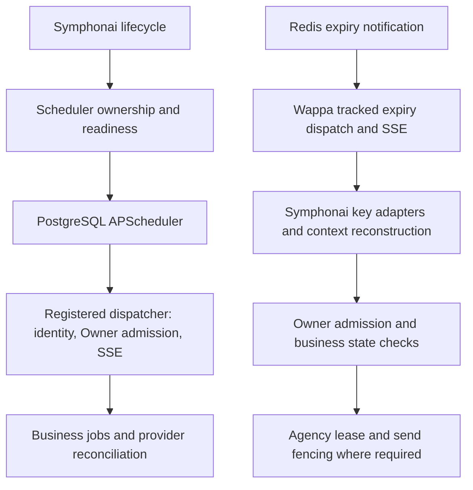
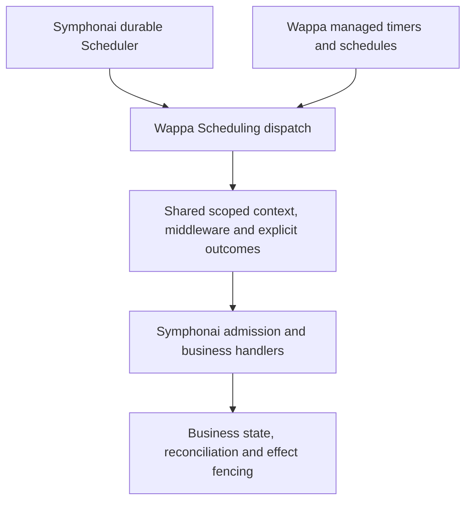

# Scheduling domain grilling session

## Authoritative scope after the user's final clarification

This section supersedes conflicting earlier recommendations and answers in this session. The earlier rounds and audits remain a historical record, not instructions to build the rejected scheduler machinery. The PRD has been rewritten around this scope; no runtime code has been changed.

**User decisions on simplification:**

> Q4,7,23 > AGREE With the simpler approach for REDIS Expiry TTL make it work as iit is right now STOP OVERENGINEERING STUFF!

> Q11 > YES also the ExpiryTTL is REdis Only, not for JSON or Memory Cache... so

> Q13 > AGREE

> Q15/16 > AGREE

> Q24 > Agree

**User's stated problem and outcome:**

> Symphonai needs to build the full context of a UserCache to send messages or analyze things on every expiry trigger or apscheduler jobs or episodes...

> What i need is a way to route all this through the WappaEventHandler and leverage it so I can already get everything ready to use in a single hook lane known as process_scheduled_tasks or something...

> wappa objective is to enable them to use the hook lane on WappaEventHandler to get all the CONTEXT built already instead of violating DRY and CLEAN ARCHITECTURE PRICNIPLES!

> And this is an issue becasue when i want to create the hearbeat feature or allowing a user to scheduled a task reminer for example... I need to build for every feature (the 5 of them) the context every TIME! Instead here the idea is to leverage WappaEventHanlder as much as POSSIBLE!

**Settled interpretation:**

- One context-bound WappaEventHandler hook serves Redis expiry, one-time jobs/reminders, expiring recurrence, non-expiring recurrence and heartbeats. Use the approved `ScheduledEvent` / `process_scheduled_event` naming; the latest `process_scheduled_tasks or something` expresses the lane's purpose rather than requiring another name round.
- Wappa builds qualified Inbox/User context, Messengers, cache access, optional database factories, middleware and SSE through its existing shared runtime. Hosts do not reconstruct Wappa dependencies for every scheduled feature.
- Native Redis TTL keeps existing pool/key/SETEX/notification behavior. The key disappears at expiry. No replay, persistent Run/attempt state, claims, leases, due indexes, payload shadow keys or terminal retention. No TTL engine for memory/JSON.
- Host schedulers own one-time/recurring/heartbeat scheduling, their databases and migrations, lifecycle, job IDs, retries, timeout/overlap/misfire policies, history and administration. APScheduler, Celery and custom implementations all use the same Wappa dispatch method.
- The external integration deliverable is a supported callback mechanism and tested examples, not an APScheduler service or a universal scheduler-management backend. This resolves Q18 without requiring Wappa to own Host scheduler setup.
- Native timer create/renew/delete/TTL queries preserve their existing semantics. Q14–Q17's custom native state-machine/default-policy requirements and Q24's independent version registry are superseded. Existing scheduler registration/policies remain owned by their current engine.
- No Wappa scheduler admin HTTP router or execution-history store. No new SQL tables, cache engine parity or workflow-tree implementation. Requested fan-out is enabled by the common hook and the Host's selected scheduler.
- Host-specific typed UserCache/Agent/Conversation dependencies remain Host-owned. The Host can initialize them once in the common scheduled hook or a shared Host wrapper over Wappa's ready runtime capabilities.
- Explicit subject mapping and existing Host identity resolution supply canonical User identity; native key rebinding uses Wappa-owned key operations with remaining TTL preserved. There is no universal alias registry or external-datastore rewrite.
- All Wappa timestamps are UTC. Clean contract renaming/removal, CHANGELOG, architecture/ADR updates, skills, scaffolds and examples are part of this Wappa deliverable. Symphonai is a reference, with adoption in a separate PRD before Gate C.

The remaining detailed engine-policy questions are closed by this ownership split, not by inventing implementation defaults. The user confirmed the final responsibility table below on 2026-11-06. The rewritten PRD is promoted to pending and the [accepted ADR](../../adr/0030-scheduled-work-dispatch.md) records its scope. High urgency is appropriate because it blocks Gate C.

## Purpose and evidence

Turn the Crons draft into an executable PRD following the [backlog rules](../../backlog/README.md). Questions are asked in groups, with a recommendation for each. A session in progress does not make its implementation backlog item `in_progress`: the PRD moves to `pending/` when design and acceptance are settled, and to `in_progress/` when its first implementation slice lands.

Three independent GPT-6.1 Terra agents reviewed current Wappa claims, proposed scheduling correctness, and Symphonai's actual scheduler and expiry integration. Their findings below are code-review evidence and design analysis, not proof from new execution tests. No live jobs or sends were run. The parent also inspected the locked fastapi-crons 2.3.0 wheel, verified its SHA-256 against `uv.lock`, and checked Redis's primary documentation.

Snapshot: Wappa HEAD `c5df375101336003eb3941c30f29fde019985461`; Symphonai HEAD `d35a1f6725597117227203932da5c18a2c541eec`. Both had pre-existing working-tree changes. Symphonai evidence includes those changes, particularly `engine/expiry/handlers/_agency_run.py` and `services/wappa/`. Existing unrelated edits are outside this session's changes. Source line numbers below refer to this snapshot, before draft corrections.

Wappa source references are relative to its repository root. Symphonai references are relative to `/home/sashanclrp/personalProjects/mimeia/products/symphonai/`.

## Superseded scope notes from earlier rounds

**Scope review requested after Q25:** The user reports never needing recovery of disappeared expiry triggers and asks which previous decisions solve hypothetical problems or add noise. Do not treat the adversarial audit's possible failure scenarios as proof of production incidents or automatically as product requirements. Reassess machinery against demonstrated Wappa/Host needs before asking more detailed implementation questions. Native expiry replay is not an established requirement. A new Redis lease/retry store cannot be justified solely by repeating the earlier bundled at-least-once recommendation. External scheduling guarantees remain owned by the selected engine.

**Q25 correction:** The user rejects Wappa-owned execution history and database tables. This supersedes earlier native-history recommendations and the history portion of Q13/Q20. Wappa is not an audit/history store. Keep only operational state needed for pending/claimed/retrying native work and live recurring definitions; remove completed one-shot execution state after completion. Execution-history persistence belongs to the Host/external engine. Do not add PostgreSQL tables, a Redis history archive or seven-day/100-Run retention. Any outcome events/logs expose information for Hosts without persisting an execution archive in Wappa. The exact pending-versus-expired-key lifecycle in Q23 is being clarified before design is finalized.

**Latest interview instruction:** "Or have the mechanisms so symphonai can do it or any given host... not necessarily our responsability! though we can make at the end a FINAL question on what things are wappa reponsability and which should be hosts (ex: symphonai) reponsabilites!" Design portable Host mechanisms rather than assuming Symphonai-specific implementation responsibility. Reserve the final question of the interview for one explicit Wappa-versus-Host ownership table. Include scheduler setup/lifecycle/datastores, native backend, dispatch/context, identities, retries, management/auth, business rules and integration guidance. Recommendations about the APScheduler adapter's ownership remain provisional until that final review; do not keep asking the same ownership question in intermediate rounds.

Round 2 overrides earlier recommendations that implied building an independent scheduler application, editing Symphonai, or preserving armed legacy triggers. Wappa provides its native scheduled-work hook, managed native timers and a plugin interface for Hosts' preferred schedulers. External engines retain their own occurrence tracking, persistence and retry lifecycle; Wappa must not create a second scheduler record merely to dispatch their work. The precise management-adapter and history scope is the next question group.

This PRD changes Wappa only, including its public contract, CHANGELOG, developer skills and Host integration guidance. Symphonai is a read-only reference; its adoption is a separate Symphonai PRD and remains a prerequisite for Gate C, not a Wappa completion gate. The release is a clean breaking cut: no legacy-name aliases, live transfer of `EXPTRIGGER` keys, maintenance cutover or rollback machinery is required. Old keys are not replayed by the new runtime; Hosts own fresh setup and any business-state rebuilding they need. This does not remove recovery requirements for new native schedules after ordinary runtime crashes.

## Round 1: scope, sequencing, ownership, delivery and language

### Q1. What must the first release deliver?

The question contrasted the full draft with a smaller first release. The recommendation proposed shared dispatch, runtime timers and recurrence, Redis durability, external firing and expiry replacement, while deferring JSON persistence, parent/child orchestration, HTTP administration and extended history.

**User answer:** "NO EVERYTHING, I don't want anything for later".

**Decision:** Keep the full scope. No reduced MVP or deferred feature bucket. Implementation may have ordered slices, but all agreed capabilities must pass before this initiative is complete. The proposed cuts are rejected. The draft's formerly optional HTTP administration and additional run history need precise requirements in a later round, rather than being silently omitted.

### Q2. Should Instagram Gate C still block implementation?

The question noted that the original after-Gate-C sequence was a preference rather than a code dependency. The recommendation was to remove Gate C as an implementation prerequisite and coordinate Host adoption separately.

**User answer:** "Actually THIS PRD becomes a requisite to proceed with GATE C. I want to integrate the new symphonai with this cron lane!"

**Decision:** Reverse the dependency. Wappa Scheduling and Symphonai adoption of the new lane are prerequisites for proceeding with Gate C. Update the execution index and Instagram plan accordingly. Do not retain the old after-Gate-C instruction.

### Q3. Is this a Wappa-owned scheduler with an external firing option?

**Recommendation:** Wappa owns durable scheduling by default. Hosts with an existing scheduler can use the shared dispatch entry point. Authorization, business meaning, recipients and business records stay Host-owned.

**User answer:** "AGREE".

**Decision:** Adopt that ownership split. Symphonai's existing durable Scheduler can remain; its Wappa-bound work must use the new dispatch lane. This does not approve removing Host admission, reconciliation or business-effect protections.

### Q4. What guarantee should retries provide after a crash?

The question used a worker crashing after sending a WhatsApp message but before recording completion. The recommendation was at-least-once execution, stable Run identity across retries, one valid claim at a time, Host idempotency, explicit lease-loss handling, and retention of the Agency Run Lease until equivalence is demonstrated.

**User answer:** "AGREE".

**Decision:** Adopt at-least-once execution. Claims and replay do not promise exactly-once external effects. Keep Symphonai's Agency Run Lease and send fencing until equivalence is demonstrated. Claim fencing, retry outcomes, cancellation races and external occurrence identity still require detailed decisions and tests.

### Q5. Should Crons remain the public name for all scheduled work?

The recommendation was Scheduling, Schedule and Run, with `self.schedules`, but initially retaining `process_cron_event` to limit migration scope.

**User answer:** "Well if we are going to rename to improve DDD language in general, lets rename EVERYTHING, anyways the next wappa release (0.34) would have a lot of breaking changes that symphonai and ohter hosts have to accomodate to!"

**Decision:** Use Scheduling as the domain name and Schedule and Run as its concepts. Rename the entire scheduling contract in the 0.34 release scope, including the handler hook, event, plugin, public imports, examples, skills and consumers. Do not preserve the old hook solely to reduce migration work. Exact replacement symbols and the code home still need agreement. No version files are changed by this design session.

## Adversarial audit: Wappa current-state claims

| Original draft claim | Verdict | Evidence and correction |
| --- | --- | --- |
| Neither existing mechanism supplies webhook-like context | Overstated | User-scoped crons already use `DispatchContextBuilder`, outbound middleware and prebuilt Platform Messengers: `wappa/core/context.py:131`, `wappa/core/dispatch/context_builder.py:151`, `wappa/core/events/event_handler.py:212`. Their identity and SSE handling still differ. |
| Static cron registration only | Confirmed for Wappa's supported interface | `wappa/core/plugins/cron_plugin.py:87,168`. Registrations install at startup; later appends do not install live jobs. This is not a claim about every capability of fastapi-crons itself. |
| Inbox-only cron receives no Messenger | Confirmed | `cron_plugin.py:261` sets `include_messenger` from presence of `user_id`; context construction also omits its cache factory. A Host could construct its own Messenger, but this lane does not supply one. |
| Cron firing creates an event, clones a handler and dispatches | Confirmed | `cron_plugin.py:208`; `wappa/core/events/cron_event_dispatcher.py:31`. The plugin's firing entry point is private. |
| Configured cron retries handle failures | Important missing qualification | `cron_event_dispatcher.py:48` catches handler errors and returns `success=False`; `cron_plugin.py:235` logs returned failure and catches context exceptions. fastapi-crons therefore sees a normally completed callback for those failures. Its locked runner retries raised exceptions, not a Wappa failure result. |
| Every worker fires unless distributed locking is configured | Default duplication risk confirmed; absolute guarantee rejected | Each plugin starts a scheduler. Locked fastapi-crons 2.3.0 `config.py:23` defaults distributed locking to false; `scheduler.py:48` otherwise chooses a local lock backend. Enabling Redis locking does not prove exactly-once occurrence delivery. Initialization can also fall back to local locks. |
| Expiry is Inbox and User scoped | False in general | Expiry keys have an Inbox, action and arbitrary identifier, which may be a User or a `wamid`: root `CONTEXT.md`, `wappa/persistence/redis/redis_handler/expiry.py:46`. Migration must distinguish them. |
| Expiry handlers lack handler-bound context and automatic middleware | Confirmed | `wappa/core/expiry/context_helpers.py:102` builds a raw Messenger; the shared builder wraps it in `MessengerPipeline`. Symphonai wraps its own expiry Messenger. |
| Expiry needs the Host to open SSE and track background work | False | `wappa/core/expiry/dispatcher.py:23` opens `sse_event_scope`, classifying the identifier by shape; `:58` uses `BackgroundWorkTracker`. Hosts may still refine identity. |
| Scheduled identity resolution already exists in the shared builder | False | Cron passes the registered User through unchanged. Webhooks derive SSE identity from webhook evidence, `wappa/core/inbound/runtime.py:150`; canonicalizing a scheduled identifier is new orchestration and does not itself reproduce that evidence. |
| Expiry has no Wappa claim or replay | Confirmed | `wappa/core/expiry/connection.py:80`, `listener.py:127` subscribe and dispatch without a claim/replay store. Disconnect losses and delayed expiry emission are also documented by Redis. |
| Expiry cannot deliver a stored payload | Confirmed | `wappa/persistence/redis/redis_handler/expiry.py:52` stores a debugging timestamp; dispatch receives the identifier and full key. |
| Memory and JSON have no expiry timers | Confirmed | Both cache factories' `create_expiry_cache` methods raise `NotImplementedError`: `wappa/persistence/memory/memory_cache_factory.py:98`, `wappa/persistence/json/json_cache_factory.py:98`. Static cron is a separate facility. |
| Existing context construction always fails strictly | False | `wappa/core/context.py:136` can degrade non-directory Messenger/cache errors to missing capabilities. Strict new-lane failure behavior must be specified. |
| Expiry removal is only an internal refactor | False | Registry, listener, `AppContext` and helpers are public imports: `docs/public-contract.md:1127`. `CronEvent` fields and exports also change. Migration must cover every public surface and caller. |
| Expiry Redis DB 3 becomes free | Only the default DB number is confirmed | `wappa/persistence/redis/redis_client.py:28`. Aliases are configurable; Host usage and existing data must be checked before reuse. |
| Existing tests establish proposed runtime guarantees | False | `tests/test_qualified_runtime_scope.py:26` and `tests/test_cron_router_registration.py:16` cover current scoping, router and lifecycle behavior. They do not establish the proposed store, identity, retry or lease guarantees. |
| Existing cron code makes this initiative in progress | False | Existing cron/context infrastructure predates this initiative. No new Schedule store, runtime management interface or claim backend was found. Design work remains a draft until settled. |

Redis confirms that disconnected Pub/Sub subscribers lose notifications and that expiry events need not occur at the exact TTL deadline: [Redis keyspace notifications](https://redis.io/docs/latest/develop/pubsub/keyspace-notifications/). Dependency inspection used the exact [fastapi-crons 2.3.0 wheel](https://files.pythonhosted.org/packages/b4/e1/1490cb3e682ba1b0d895873363b03b5fc7da568f2259681e8ca8d6ef2f4e/fastapi_crons-2.3.0-py3-none-any.whl) pinned by `uv.lock`, rather than assuming its current defaults.

## Adversarial audit: proposed scheduler correctness

These are failures the implementation must prevent or explicitly document. They are not evidence that an unimplemented backend currently has these bugs.

| Priority | Failure scenario | Requirement or decision needed |
| --- | --- | --- |
| Critical | Worker A pauses beyond its lease; B acquires the Run; A resumes and sends | Owner tokens and generation-checked renew/complete/release; stale workers cannot mutate scheduler state. Scheduler fencing alone cannot fence arbitrary external sends. Preserve Host effect idempotency and send fences. |
| Critical | A claimed timer completes after an inbound event rearms it, deleting the newer deadline | Separate Schedule lifecycle from Run/attempt state and use atomic generation checks. Define claim/cancel/pause/rearm linearization. Cancellation cannot retract an effect already started. |
| Critical | Cutover reads TTL, then an old writer renews or the old listener fires before deletion | Coordinated writer/listener handoff, conditional deletion, repeatable idempotent transfer, crash recovery and reconciliation. Host action decoders remain necessary. A live scan/create/delete recipe is insufficient. |
| High | Two distinct rearms share the same timestamp and Run ID | Occurrence/generation identity distinct from wall time; retries and recovery retain the same occurrence ID. Ad-hoc external fires need a caller-stable occurrence identity. |
| High | External scheduler sees `fire` return a failed result as successful completion | Typed outcomes and an explicit adapter retry/error policy covering context failure, rejection, handler failure, timeout and unknown effect outcome. |
| High | Worker restarts without knowing which per-Inbox sorted sets contain due work | Durable scope discovery or a global/sharded discoverable due index, expired-claim index, startup recovery and periodic repair. Define system schedules too. |
| High | Worker misses a wakeup between checking the earliest score and subscribing | Subscribe/check/sleep protocol and fallback repair. Timing is a measured latency objective; downtime, load and lost wakeups defeat a strict execution deadline. |
| High | Recurrence overlaps while another occurrence retries and a third queues | Independent Schedule, Run and attempt state; bounded queues/catch-up; explicit overlap/retry interaction, `run_count`, retry exhaustion and `until` behavior. Reconcile `coalesce` with `run_once`. |
| High | Phone-keyed timer becomes unreachable after User identity changes to BSUID | Canonicalization or alias migration for create/get/cancel/rearm and list, with collision rules; firing-only resolution is insufficient. |
| High | Old/new workers upsert different static definitions and resurrect a cancelled schedule | Stable declaration identity including scope, configuration ownership/version, preserved runtime state, removed-definition policy and rolling-deploy rules. |
| High | Shutdown releases a lease while its handler still runs | Stop claims, drain, cancel and await termination before release. Define behavior for work that cannot be proven stopped. |
| Medium | Lua operations span incompatible Redis partitions or cross-Inbox locks | Specify supported topology/key placement before promising atomic multi-key transitions. Include uniqueness, labels, records, due/claim indexes and concurrency leases. |
| Medium | Memory, JSON and Redis are advertised as equally durable | Shared behavioral interface with explicit capability differences. Memory is volatile; JSON needs atomic persistence and single-process restrictions; Redis needs persistence/failover/eviction assumptions. |
| Medium | One Lua call is described as equivalent cost to `SET EX` | Round trips are not CPU, contention or memory cost. Benchmark realistic inbound rearm load, indexed labels and p95/p99 dispatch delay. One-read keyed lookup also depends on record layout. |
| Medium | DST, fixed-delay recurrence or a clock jump creates unexpected runs | Specify cron parser, IANA timezone, UTC precision, DST folds/gaps, interval semantics and bounded misfire recovery. |
| Medium | Debounce `max_delay` claims execution by a deadline | Define its epoch and latest intended scheduled deadline. It cannot promise execution by that time during downtime or overload. Test rearm before/after claim and after completion. |

The reliability reviewer recommended a reduced initial implementation as a way to lower risk. Q1 rejects reducing delivery scope. These checks therefore become requirements across ordered implementation slices within the full deliverable.

## Symphonai today and the proposed improvement

Symphonai's Scheduler is already durable and dynamic. `backend/symphonai/services/scheduler/lifecycle.py:15`, `service.py:112` and `dispatcher.py:103` provide lifecycle supervision, PostgreSQL persistence, supported single Scheduler Owner deployment, readiness, registered dispatch, identity/SSE, optional single-flight and bounded drain. Existing jobs include campaign dispatch, conversation reconciliation, Template catalog/commit reconciliation, quota retention and notification dormancy. Optional packages add their own jobs. Consumer-specific reminder registrations still need discovery; this review does not claim all consumers were audited.

The campaign tick is a system sweep with batch concurrency, not a cron per recipient: `backend/symphonai/engine/lifecycle/scheduler_handlers/whatsapp_template_campaign_dispatch_handler/_dispatch.py:43`. `ScheduledTemplateSendAdapter` owns domain/provider work that a Wappa context builder cannot replace.

The proposed graph centralizes Wappa capability construction and gives high-write-rate expiry timers recoverable occurrences with payloads. It preserves Symphonai's business checks. It does not claim that every system sweep must construct an Inbox context, or that scheduler-level SSE is missing today.

| Timer family or proposed deletion | Actual behavior and migration obligation |
| --- | --- |
| Message sync | `backend/symphonai/domains/user_runtime_cache/services/user_cache_service/_expiry.py:61` measures oldest unsynced-message age. After the threshold it preserves an existing timer or arms a buffer if absent. This is not equivalent to `first_scheduled_at + max_delay`; media metadata timing must remain intentional. |
| Conversation window | `backend/symphonai/core/messenger/window_guard_middleware.py:85` reads TTL during outbound sends, checks target/SSE identity, and currently permits a send if the read fails. Define timer-as-state behavior for absent, running, completed, read-error and migrated-identity cases. Dispatch delay must not accidentally extend the messaging window. |
| Agent trigger and proactive Episode runs | `_expiry.py:170` validates snapshot, block revision, Episode identity and queued attempt under the cache mutation lock. Payloads replace encoded transport data, not these checks. Adaptive delays, rearming and no-progress fuses remain. |
| Human takeover | `backend/symphonai/domains/human_takeover/services/__init__.py:71` computes active state/countdown from the maximum TTL of separate API and Template state keys. A separate expiry trigger publishes a notification. Keep those state authorities unless a deliberate redesign preserves overlapping activation semantics. |
| Template rollback | Timer is keyed by `wamid`, not User. Preserve send-record checks and the difference between retryable cleanup and a send already accepted by the Platform. Generic retry is not an unconditional replacement for business reconciliation. |
| Idle Nudge Ladder | Legacy rung code remains, but `backend/symphonai/engine/expiry/app_handlers.py:39` rejects implicit `nudge_ladder` activation. Require consumer evidence before classifying it as active. |
| Episode rung/deadline mirror | `backend/symphonai/domains/engagement/handlers.py:84` uses `nudge_due_at` to reject stale firings. Delete only after equivalent generation/deadline protection is proven. |
| App expiry extensions | `ExpiryExtensionHandler` is a profile-facing contract with admission and canonicalization, `backend/symphonai/engine/expiry/app_handlers.py:51`. Its migration includes the extension interface and consumers, not only the `app_` prefix. |
| Agency Run Lease | `backend/symphonai/engine/expiry/run_serialization.py:130` renews a live claim and checks it through Business Fact send fencing. Generic `concurrency_key` is not established as equivalent. Keep until separately proven. |
| Expiry shell and aliases | Potentially removable after admission, exception outcomes, canonical identity and extension compatibility move to their proper owners. Do not drop those responsibilities with the files. |
| AppContext and expiry helpers | Used outside expiry by database sessions, middleware, SSE, scheduler handlers and other services. Inventory and replace every caller before deleting public helpers. |
| TTL readers and cleanup | Agent-trigger TTL also participates in recovery/business-fact paths; conversation closure and rollback delete takeover triggers. Migrate reads and deletion workflows as well as trigger writers and handlers. |

## What would demonstrate the architectural improvement?

There is no measured 10x result. The improvement must be shown through fewer Host-owned Wappa construction paths and stronger tested recovery, with latency and operational cost measured against the current code.

1. One supported Wappa dispatch interface serves static definitions, runtime schedules and external schedulers with isolated scoped capabilities and typed outcomes.
2. Symphonai expiry families stop parsing Wappa key namespaces or assembling raw Messengers and middleware; Host admission and business checks remain explicit.
3. Crash/restart recovery retains occurrence identity and due work under documented storage assumptions. Tests include a crash after an external effect, rather than asserting exactly-once sends.
4. Rearm/cancel/claim/completion races preserve the latest generation. A stale claimant cannot change current scheduler state. Agency send-fence equivalence is verified independently.
5. Timer migration preserves window, takeover, message-sync and Episode semantics, including identity changes and stale-rung protection.
6. Real-Redis multi-process tests supplement fakes for atomic claims, lease expiry, wakeup recovery and cutover. JSON and memory get the same applicable behavior suite with documented durability limits.
7. Measure p95/p99 timer dispatch lag, inbound-message rearm cost, Redis operations/contention, missed/replayed Runs and the number of Host capability-construction call sites removed. Agree numeric performance budgets before implementation acceptance.
8. Preserve or deliberately replace Scheduler acceptance/readiness, intended fire time, correlation, Owner diagnostics, registered job limits, provider-effect identities and bounded drain.
9. Original audit recommendation, rejected in Q10: preserve armed legacy timers through an idempotent cutover. The accepted release instead removes the old runtime cleanly and documents that legacy keys are not replayed.
10. Full Wappa implementation, documentation and skill/import updates complete this Wappa initiative. Symphonai adoption is a separate PRD; both remain prerequisites for Gate C.

## Round 2: public contract and correctness foundations

The user's answers below settle or qualify each recommendation. Where an answer changes scope, it takes precedence over the original recommendation.

### Q6. What are the exact replacement names?

**Recommendation:** Public package `wappa.scheduling`; domain Scheduling; facade `Scheduling`; handler management attribute `self.schedules`; event `ScheduledEvent`; hook `process_scheduled_event`; lifecycle plugin `SchedulingPlugin`. Keep `cron` only as a recurrence expression. Rename imports, examples, skills, HTTP paths and consumer code in the same delivery, with no old-name aliases. The proposed HTTP base is `/scheduling`; detailed route shapes remain a later decision.

**User answer:** "AGREE".

**Decision:** Adopt these Wappa names. Consumer migration instructions ship here; actual Symphonai/other Host code changes are outside this PRD per Q9.

### Q7. Should Schedule, Run and execution attempts have separate state?

**Recommendation:** Yes. A Schedule defines future work; a Run is a stable occurrence; an attempt is one execution of that Run. Retries preserve Run identity. Rearming creates a new generation, and an older attempt cannot complete, delete or overwrite it. This supports the full overlap, retry and history scope without treating `status=running` as the complete Schedule state.

**User answer:** "AGREE, though how we will keep track of run-ids? for example APScheduler already manages this by its own, the idea is not to build a FUL scheduler app, but a plugin to enable hosts to connect tehir prefered methods no? plus the redisexpiry handler which iis NATIVE to wappa, this should work natively as a hook..."

**Decision:** Keep Schedule, Run and attempt distinct for native managed work; do not duplicate an external engine's schedule/occurrence store. The native backend generates and retains occurrence identity. External adapters pass their engine's stable occurrence identity into the shared scheduled-event hook and own retry tracking. Whether all external management operations are delegated through an adapter or dispatch-only integration suffices is asked next. A full scheduler application is not the product.

### Q8. How should external dispatch report failure?

**Recommendation:** Use typed outcomes and make the normal external dispatch call raise a typed failure for rejected, failed or uncertain execution, so an external scheduler cannot silently record success. Provide explicit non-raising inspection when needed. The built-in worker owns retries for its stored Runs; external schedulers own retrying their occurrences and must pass stable occurrence IDs. Do not let both layers independently retry the same external occurrence.

**User answer:** "AGREE".

**Decision:** Adopt typed outcomes, failure propagation by default and one retry owner per execution path.

### Q9. Should migration preserve existing business-state authority?

**Recommendation:** Yes. Keep human-takeover state keys, messaging-window admission, Episode generation/block checks, oldest-message sync timing and Agency send fencing in the Host while moving trigger transport and Wappa capability construction. Timer dispatch delays must not extend business deadlines. Any replacement of these state models needs an explicit equivalence test, rather than being assumed to follow from storing a Schedule.

**User answer:** "Symphonai right now is a REFERENCE, we are not going to touch symphonai, thats a separate symphonai PRD, what we will create is in the Changelogs and skills the information needed for symphonai to properly implement all this".

**Decision:** No Symphonai implementation, data migration or live Host acceptance in this Wappa PRD. Use the audited cases to design Wappa contracts and representative tests. Ship CHANGELOG, skills and guidance that describe scope binding, occurrence/retry ownership, identity, native timers and business-state responsibilities. Actual Host behavior and acceptance belong in a separate Symphonai PRD.

### Q10. What kind of expiry cutover must we support?

**Recommendation:** Allow a coordinated maintenance handoff with paused writers, a durable inventory of due work, explicit ownership transfer, near-expiry reconciliation and rollback. The detailed protocol must account for keys expiring while inventory and transfer run; pausing writers does not pause Redis TTLs. If uninterrupted operation is required, explicitly design and test a live versioned handoff instead. The draft's scan/create/delete sequence is insufficient for either guarantee by itself.

**User answer:** "NO, BREAKING CHANGES NOW! I want a clean app... breaking everything FAST! NOW!"

**Decision:** Reject the maintenance/live handoff recommendation. Remove legacy cron/expiry contracts in a clean breaking release with no aliases, dual runtime, armed-key importer or cutover/rollback tool. Document fresh setup and that legacy trigger keys will not execute. Native durability and crash recovery after adoption remain required; clean removal is not a reason to omit correctness in the new lane.

## Round 3: native engine, external identity and management depth

Q11–Q13 are accepted as recommended. The user answered "AGREE" to each.

### Q11. Which schedule kinds does the native backend execute?

**Recommendation:** Preserve all five kinds in the native backend: Timer, one-time task, expiring recurrence, non-expiring recurrence and heartbeat. `SchedulingPlugin` owns composition and the shared hook; a backend owns trigger calculation, persistence and claims. Redis is the default managed backend, with memory/JSON under their stated limits. Hosts may choose external-only dispatch and run their own scheduler without starting Wappa's native engine. This delivers all kinds without requiring a separate scheduler application or mirroring external schedules.

**Decision:** Adopt this native/backend ownership and external-only mode. No schedule kind is deferred.

### Q12. How does Run identity cross the external dispatch interface?

**Recommendation:** Native occurrences receive an opaque generated Run ID persisted before execution and reused across retries/recovery. External callers supply a source namespace and an opaque occurrence ID, reused when retrying that occurrence. Wappa exposes their qualified identity in `ScheduledEvent` without writing a second schedule/history record. An external schedule ID alone is insufficient because its recurring occurrences need different identities. Propagating an ID provides correlation and supports Host idempotency; it does not itself deduplicate external side effects.

**Decision:** Adopt this identity contract. External occurrence IDs are required; Wappa does not fabricate durable external history or claim automatic effect deduplication.

### Q13. What management should Wappa expose for native schedules?

**Recommendation:** Keep `self.schedules` control/query operations, bounded native Run history and an opt-in Host-authenticated `/scheduling` router. Do not build a dashboard or retain a second external engine job/history database. External-only Hosts can use the hook alone. Management of externally owned schedules, when desired, must go through an explicitly registered backend adapter rather than invented Wappa records. Exact history limits and route/auth details follow after the management scope is confirmed.

**Decision:** Adopt this management scope. Router composition/auth, history retention and adapter capabilities still need implementation-level requirements.

## Round 4: native execution policies

Q14–Q17 are accepted as recommended. The user answered "AGREE" to each and reiterated that the design must serve Symphonai's APScheduler integration and its extensive use of Wappa's native Redis expiry handlers. These defaults apply to native managed work; an external engine retains its own policies. The concrete contract examples below address that requirement without editing Symphonai.

### Q14. What should create and reschedule mean?

**Recommendation:** `schedule` creates and reports a typed conflict for an existing `(scope, action, key)`. `reschedule` creates if absent and otherwise atomically replaces the pending generation. An executing old generation may finish, but cannot delete or overwrite its replacement. The debounce ceiling restarts after a generation finishes; it limits the intended deadline, not actual execution during downtime.

### Q15. What overlap and missed-run defaults should native schedules use?

**Recommendation:** Timers and one-time tasks run once when overdue. Recurring schedules default to no overlap and coalesce missed occurrences into one Run. Heartbeats default to no overlap and skip missed ticks, resuming on the next tick. Call the coalescing misfire policy `coalesce` consistently. Keep `allow`, bounded `queue` and bounded `catch_up` as explicit options. Proposed initial queue/replay cap is 100 occurrences per Schedule; overflow is visible in outcomes rather than silently building an unbounded backlog. Exact overflow ordering is specified when these options are agreed.

### Q16. What retry and timeout defaults should native work use?

**Recommendation:** Zero automatic retries for handler failures by default, with configurable exponential backoff and jitter when opted in. Crash/lease recovery still replays uncertain work under the accepted at-least-once contract. Default handler timeout is 300 seconds, or 30 seconds for heartbeats, configurable per Schedule. Renew claims while executing and cancel cooperatively on timeout or lease loss; claim fencing rejects stale completion. These runtime limits do not override the external engine's policies.

### Q17. What should cancel, pause and parent cancellation do?

**Recommendation:** Cancel/pause prevent future claims and do not forcibly interrupt a running handler. Cancellation is permanent for that generation; resume applies only to paused schedules. Parent cancellation affects descendants only with explicit `cascade=True`. Cancelling an already absent/terminal target is idempotent. Bulk operations stay within the explicitly selected scope. A running handler may still have effects, so none of these operations promises to retract an already-started send.

## Concrete integration contracts from Symphonai

Rechecked against the current tree after Q17. Symphonai pins `apscheduler==4.0.0a6` in `backend/pyproject.toml:31`. Its dispatcher reads `current_job` and `scheduled_fire_time`, constructs a Host `ScheduledEventRecord` and dispatches through its registry. Its observer already tracks per-execution `event.job_id` separately from `event.schedule_id`: `backend/symphonai/services/scheduler/service.py:178`. Preserve that distinction in the adapter; a Host record's generic `job_id` must not be assumed to identify a unique recurring occurrence.

| Existing reference path | New Wappa contract to demonstrate | Ownership that remains with the Host/external engine |
| --- | --- | --- |
| APScheduler → `_dispatch_scheduled_job` → Host registry | An adapter supplies source/occurrence identity, intended fire time, action, explicit Inbox/User scope and payload to the shared scheduled-event dispatch. Failures propagate to the caller. No native Schedule or history record is manufactured. | PostgreSQL schedule/job store, Scheduler Owner, readiness, task registration, recurrence, job limits, retries, Host record and business handler routing. |
| `reset_conversation_window` → `expiry_cache.set(action, user_id, ttl)` | Scoped native `self.schedules.reschedule(action, after=...)` creates/renews a timer and fires `process_scheduled_event` with prebuilt Wappa context. Native lookup exposes its intended deadline even when dispatch is late. | WhatsApp window admission and the authority/meaning of the deadline; an overdue handler cannot extend an allowed messaging window. |
| `reset_message_sync_timer` → TTL read/set | Native timer create/rearm/get/cancel supports the existing conditional renewal pattern, with payload and identity supplied explicitly. Generic debounce ceiling is available without asserting equivalence to oldest-unsynced-message logic. | Oldest unsynced-message age, metadata offset/buffer, reconciliation and persistence policy. |
| `agent_trigger` / Episode expiry → handler shell → Agency | Native Run has stable identity, generation-checked rearm, scoped context, payload and optional concurrency coordination. Tests include an inbound rearm while a prior Run completes. | Agency admission/live send fencing, Episode generation and queued-attempt checks, adaptive delay and business no-progress fuses. |
| `tpl_rollback` keyed by `wamid` | An Inbox-only timer uses `key=wamid` and opaque payload; the dispatch does not misclassify the message ID as a User. Scoped context can be requested once the Host resolves the record's User. | Send-record lookup, acceptance reconciliation and decision to retry cleanup. |
| Human-takeover expiry and app extension actions | Native hook handles timer notifications; documented extension routing preserves Host-selected action names and payloads. | Distinct takeover state keys/countdown, profile extension contracts and authorization. |

The Wappa delivery includes representative contract tests and skill examples for these paths. It does not call Symphonai handlers, import Symphonai business models or modify its code. The tests prove Wappa behavior; the separate Host PRD proves actual adoption.

## Round 5: integration shape and scoped context

Q19–Q21 are accepted. Q18 remains open pending the ownership clarification below.

### Q18. Should an APScheduler adapter ship with Wappa?

**Recommendation:** Yes, as an optional integration, with a tested recipe/adapter targeting the APScheduler 4 contract used by the reference Host. It connects a Host-owned scheduler to the Wappa hook and delegates supported management operations. It does not start a second APScheduler, replace its datastore or take ownership of Host supervision. Isolate any version-specific behavior and make unsupported management explicit. APScheduler is not a mandatory dependency for native Redis timer Hosts.

**User question:** "I mean yeah, but the DB Setup and all that belongs in symphonai no? OR we will bring APScheduler as a Service to wappa, and then symphonai will use OUR service and delete theirs?"

**Clarified recommendation, awaiting agreement:** Keep APScheduler database setup, schema/migrations, datastore, execution ownership, readiness, task registration and scheduling lifecycle in the Host. Wappa's optional adapter accepts the Host-owned scheduler and translates supported operations and occurrences to the Scheduling interface/hook. It does not create an APScheduler service or database tables. Wappa separately owns the agreed native Redis engine and memory/JSON implementations. Symphonai may eventually delete redundant Wappa context construction when adopting the adapter; deletion of its Scheduler service is not a requirement or claimed benefit. Importing an APScheduler service into Wappa would be a new backend/lifecycle ownership decision, with additional scope beyond this adapter recommendation.

### Q19. How should Host code outside a handler acquire scope?

**Recommendation:** `Scheduling.from_app(app)` exposes dispatch and schedule management without requiring a fake inbound message. Both entry points accept explicit qualified Inbox/User scope; the handler's `self.schedules` defaults to its current scope. Keep `self.scope(...)` for obtaining another User/Inbox's prebuilt context and scoped scheduling interface, with lifecycle-safe context management and isolated SSE identity for work performed in that scope. Authorization remains Host-owned.

**User answer:** "AGREE".

**Decision:** Adopt this scoped access contract for both handler and Host-service entry points.

### Q20. What replaces the expiry TTL read used by countdowns and send guards?

**Recommendation:** Scoped lookup by action/key returns the current timer generation with its status and intended deadline, including when it has been claimed but its handler has not completed. Derive remaining time as `max(0, deadline - now)`. Missing/completed/cancelled timers return `None` through that current-generation lookup; backend failure raises a typed error rather than becoming a missing timer. Query by Schedule ID/history can still inspect retained terminal records. Dispatch delay never moves the deadline forward. Host send-window admission and human-takeover state remain Host decisions; the skill examples explain this explicitly.

**User answer:** "AGREE".

**Decision:** Adopt current-generation deadline lookup, separate retained terminal queries and typed storage failures. Do not treat a late-running timer as extra time for a business deadline.

### Q21. Who handles a User identity change after a native timer is armed?

**Recommendation:** The Host supplies authoritative identity evidence through its resolver and explicitly notifies Wappa when canonical identity changes. Wappa canonicalizes scoped operations and offers a native rebind operation to move pending work from old User identity to new identity while preserving Schedule/Run identity. Never infer User identity from a `wamid` or identifier shape. Detect conflicting scoped keys explicitly rather than silently merging them. External schedule identity/data migration remains owned by its engine/Host; Wappa resolves the supplied dispatch subject.

**User answer:** "AGREE, Symphonai already does this internally for a lot of redis keys, so we should do the same for all shceduled tasks".

**Decision:** Identity rebinding applies consistently across all native scheduled-work kinds, preserving Schedule/Run identity and maintaining due, uniqueness and query indexes. Hosts supply authoritative old/new User identity within one qualified Inbox. In-flight generation/state races and conflicting scoped keys must be tested. Externally stored schedule changes remain with the Host/engine, reached through an explicitly supported adapter operation; Wappa cannot silently rewrite an external datastore.

## Round 6: time, storage, declarations and limits

Q22 and Q24 are accepted, Q23 is being clarified against the existing Redis pool, and Q25 rejects native history. Backend mechanisms are discussed here; the final ownership table remains reserved for the final question.

### Q22. What are native recurrence and lifetime rules?

**Recommendation:** Store timestamps in UTC, require timezone-aware absolute datetimes and use explicit IANA timezones for cron expressions, default UTC. Intervals are fixed-rate, anchored to their scheduled times. A missing DST local time is skipped; a repeated local time executes once at its first occurrence. `until` includes occurrences scheduled exactly at its boundary and does not cancel already admitted Runs/retries. `max_runs` counts created logical Runs, excluding retries and skipped ticks. Heartbeats persist until explicitly cancelled; ordinary process shutdown suspends execution rather than cancelling persisted definitions. External engines retain their own temporal semantics, which adapters report rather than reinterpret.

**User answer:** "Agree. Everything is in UTC. Each host like symphonai has mechanisms to render UTC timestamps to a given timezone and visceversa so yeah".

**Decision:** UTC is Wappa's temporal contract; Hosts own local-time conversion and presentation. Do not require a Host-local timezone to interpret any stored/returned Wappa timestamp. The accepted recurrence/lifetime semantics remain, with native examples in UTC and external engines retaining their own recurrence configuration.

### Q23. What is the native Redis/storage shape?

**Recommendation:** Use a dedicated scheduling namespace/pool in one logical Redis database, with discoverable application-wide due and claimed-expiry indexes and scoped records. No scan of all Inboxes is needed to discover due work. Keep atomic transitions on compatible keys; topology support must be explicit and tested. Subscribe/check/sleep plus a repair poll handles wakeups; correctness never relies on Pub/Sub delivery alone. Redis persistence/eviction guarantees are deployment requirements. Memory is volatile and single-process; JSON is single-process with atomic file replacement and restart recovery. No silent fallback from failing durable storage to memory.

**User question:** "WE already have the DB4 i think the one for REdisExpiryTrigger no? for the timer tasks, heavily used on symphonai BTW... no?"

**Verified code:** `wappa/persistence/redis/redis_client.py:28` maps `expiry` to logical Redis DB 3, the fourth database when counted from one; DB 4 is `ai_state`. Explicit pool URLs can override these defaults. `wappa/persistence/redis/redis_handler/expiry.py:80` uses `SETEX`; `wappa/core/expiry/connection.py:142` attempts `CONFIG SET notify-keyspace-events Ex` before subscribing. This is the native mechanism the user is referring to. No new SQL database or table is implied by a Redis database index.

**Clarified recommendation, not yet settled:** Reuse the existing timer Redis pool/database with new scheduling keys rather than introduce another pool. Store only active scheduling/claim/retry state, clean up completed one-shot state, and keep live recurrence definitions only as needed. Recovery of due work across a missed notification requires active state beyond a vanished TTL key. Clarify that lifecycle explicitly; do not silently replace the accepted at-least-once contract with the old at-most-once Pub/Sub mechanism.

### Q24. What should static declarations do at startup?

**Recommendation:** Stable declaration identity includes scope. Repeated identical startup declarations are idempotent and preserve deadline/history/pause/cancel state. A changed definition requires an explicit revision/replacement policy; old and new workers cannot alternately overwrite it. Removing a definition from code does not silently delete durable work: removal/cancellation must be explicit. Surface conflicting declarations as typed configuration failures.

**User answer:** "Agree".

**Decision:** Adopt declaration identity, explicit replacement/removal and preservation of operational pause/cancel/deadline state. References to execution-history preservation in the recommendation are superseded by Q25; declaration control state is operational state, not a Run archive.

### Q25. What initial data and history limits should apply?

**Recommendation:** Payload maximum 16 KiB of encoded JSON; at most 16 labels with exact-match label filtering, plus the already proposed action/key/prefix filters. Retain native terminal Run/attempt history for up to seven days and at most 100 Runs per Schedule, whichever limit is reached first. Keep terminal Schedule records for seven days, with cleanup bounded so idle definitions do not accumulate forever. Heartbeats retain current state/last outcome/counters by default, with per-Run history opt-in. Live pending/running state is never discarded by history cleanup. All limits are configurable with documented bounds; errors never silently truncate payloads or filters. External engine history is not copied.

**User answer:** "Are we creating DB tables? This is not wappa responsability.... why would we store history? and where? and how? in REDIS? BULLSHIT! once a expiry triggers triggers the key disappears (as per the KEY NAMESPACE TRIGGER with setup in redis setting at startup for the ExpiryTriggers to work)".

**Decision:** Reject the Wappa history/archive proposal. No SQL execution tables, no Redis execution archive and no terminal-record retention requirement. Expose outcomes through the call/hook/logging mechanisms so Hosts may persist their own history. Retain only operational native state needed for agreed execution/recovery semantics. Payload and label numeric limits were not accepted by this answer and remain proposed defaults, rather than approved requirements. Clarify lifecycle in Q23 before closing that branch.

## Scope review: potential overengineering, not yet approved cuts

The interview's recommendations expanded a shared context/dispatch problem into a scheduling-engine implementation. Several approvals bundled a useful behavior with a costly proposed mechanism. The user explicitly wants the complete requested functionality; using existing scheduler/Host mechanisms is not deferring that functionality. The alternatives below retain that distinction. They are recommendations for the requested review, not unilateral cancellation of previously requested use cases.

| Decision or proposal | Demonstrated need versus added machinery | Recommendation for responsibility review |
| --- | --- | --- |
| Q4/Q7/Q11/Q23: custom Redis due indexes, persistent Run/attempt records, leases, recovery and wakeup repair | These implement replay guarantees absent from TTL expiry. The user reports no experienced need for replay; Symphonai already has a durable APScheduler runtime for work that needs its guarantees. | Do not make a new durable Redis scheduler a prerequisite for moving expiry work into a context-bound hook. Keep native TTL timer behavior unless a concrete requirement selects stronger delivery. Delegate recurrence/retry persistence to the selected scheduler. |
| Q11: every kind implemented independently in Redis, memory and JSON | All requested schedule kinds are product behaviors; implementing all engines is a separate decision. Current native expiry is Redis-specific and Symphonai uses an existing recurrence engine. | Support all kinds through the integration contract and actual selected engines. Do not infer that every cache backend must implement a persistent scheduler. Confirm supported timer backends in the final scope table. |
| Q13/Q25: native execution history | Explicitly rejected by the user; not necessary for scoped dispatch. | Removed. Hosts/engines own history; ordinary failures remain observable. |
| Q13: generic admin HTTP router | No concrete caller was identified. Host administration already needs business authorization and its own job model. | Recommend Host routes over the scheduling mechanism unless a specific Wappa HTTP consumer is required. Do not add a new auth/control-plane product solely because it was in a bundled recommendation. |
| Q15/Q16: generalized queue/catch-up/retry engine | Useful scheduling policies already belong to APScheduler or another chosen engine. They are not automatically requirements for the native TTL hook. | Expose or document selected-engine behavior. Avoid a second implementation of queue/backoff/misfire semantics in Wappa's dispatch. |
| Q24: durable declaration revisions and cancellation registry | The underlying scheduler already owns registration/persistence; a new registry adds an independent source of configuration state. | Keep registration idempotent using the selected engine's mechanisms. Add revision machinery only where a concrete conflicting-deployment requirement demands it. |
| Parent/child trees, cascade cancellation and cross-job concurrency leases | Fan-out is a requested use case; a durable workflow graph is not necessarily required to create independent jobs. Symphonai's Agency already has domain-aware fencing. | Keep fan-out possible. Prefer opaque correlation metadata and Host orchestration/engine concurrency until a native hierarchy is demonstrably necessary. Never remove existing Host guards as an assumed benefit. |
| Q21: identity rebinding for scheduled work | Concrete need: Symphonai already realigns keys after identity changes. A second universal alias/migration registry would duplicate Host identity authority. | Keep scoped identity resolution and mechanisms to rename/rebind Wappa-owned keys. Host supplies authoritative mapping. Do not create an independent identity system or rewrite external datastores. |
| Q22: native DST/cron recurrence implementation | Host uses UTC and an external recurrence engine already interprets triggers. | Keep Wappa timestamps UTC and delegate recurrence calculation to the selected engine. Local-time conversion is Host-owned. |
| Q25 numeric limits and the Q15 queue cap | 16 KiB, 16 labels, 100 occurrences and retention numbers were recommendations without a measured workload; Q25 did not approve resource limits. | Treat them as proposed operational limits, not discovered requirements. Avoid unrelated indexed-query infrastructure unless a real list/cancel use case needs it. |
| Typed failures and timeout defaults | Real current bug: Wappa cron handler exceptions are swallowed before scheduler retry can see them. A large taxonomy of uncertain/rejected states is additional design. | Preserve ordinary exception propagation, context validation and clear logging. Add specialized types only where callers need distinct handling. Engine/Host execution limits should remain authoritative for external jobs. |

The highest-value retained work is one supported scheduled-event dispatch hook; Inbox/User-scoped prebuilt capabilities; the Inbox-only Messenger fix; native Redis timer dispatch through that same context path; runtime timer create/rearm/cancel/deadline lookup; external scheduler integration that propagates failures; UTC identity; clean naming/removal; and accurate CHANGELOG/skills/examples. A completion gate is required for concrete timer and external dispatch scenarios, not for proving every hypothetical distributed-system property.

The final Wappa-versus-Host responsibility table must resolve these proposed simplifications before the PRD is marked ready. Do not continue expanding implementation detail against the superseded assumption that Wappa must own every scheduling guarantee.

## Q26, final question: Wappa versus Host responsibilities

**Question:** Does the table below match the intended boundary and complete our shared understanding?

**Recommended:** Adopt this table. It preserves all five requested behaviors through the common lane while keeping trigger-engine ownership explicit. Upon confirmation, record the architectural boundary in an ADR and promote the rewritten PRD to `pending/261106-high-scheduled-task-dispatch.md`; implementation has not started.

| Responsibility | Wappa | Host / selected scheduler |
| --- | --- | --- |
| Common hook and event | Public dispatch, ScheduledEvent, fresh WappaEventHandler clone and process_scheduled_event | Route actions to business/Agent feature logic |
| Runtime context | Qualified Inbox/User resolution, credentials, Messenger/Platform Messenger, scoped cache infrastructure, optional DB factories, middleware/SSE and existing lifecycle tracking | Supply authoritative task subject and identity evidence; initialize typed domain dependencies once in the hook/shared Host wrapper |
| Native Redis timers | Existing TTL infrastructure and set/renew/delete/get_ttl behavior, expiry notification routed to the common hook, scoped key/rebind mechanisms | Choose actions, identifiers and delays; retain business payload/state; map identifiers to their subject |
| One-time, recurring and heartbeat scheduling | Supported async callback entry point and tested integration examples | APScheduler, Celery or custom engine; cadence/end conditions, datastore/setup, lifecycle, registration and execution policies |
| Reliability and business coordination | Preserve existing Redis delivery behavior, propagate awaited errors and log tracked background failures | Required retries/recovery, job IDs/idempotency, single-flight, Agency/send fences, reconciliation and business guarantees |
| Administration and history | No new management router, tables or execution-history store | Job administration/auth, history and domain persistence |
| Contract and adoption | Clean public rename, Wappa callers, public docs, applicable ADRs, CHANGELOG, packaged skills/scaffolds/examples | Integrate into Symphonai/other Hosts under their separate PRDs |

**User answer:** "Agree proceed commit everything so far".

**Decision:** The responsibility table and shared understanding are accepted. Session complete. Promote the PRD to pending, record ADR-0030, reconcile references and commit the session/documentation. This does not authorize or claim runtime implementation.

## Final PRD review

An independent blind extraction identified 36 artifacts and subparts in the PRD prose. Reconciliation mapped them to the owning Requires/Complexity Budget rows or the existing backlog lifecycle rule, and made plugin composition explicit. A separate simplification critic found no blockers to the approved scope. Its wording refinement was applied: external callers may supply a known subject identifier, and the Host resolver supplies the canonical User before the event reaches the hook and before User cache construction. Reuse of current lifecycle wiring and native key operations is explicit; the review did not add scheduler infrastructure. The pending PRD passes the optimized-PRD validator. ADR-0030 records the accepted design, while implementation remains pending.

## Documentation changed so far

- The session preserves original answers and the three-agent audit, with the latest scope placed first as authoritative.
- The original draft is rewritten as a scheduled-dispatch/context PRD. It has scope, explicit exclusions, a Requires table, a Complexity Budget and concrete exit criteria.
- Root CONTEXT and ARCHITECTURE, the context map and relevant context architecture notes distinguish the planned common dispatch lane from the unchanged Redis TTL mechanism.
- The execution index and Instagram plan record Wappa delivery and a separate Symphonai adoption PRD before Gate C, without imposing a replacement scheduler engine.
- No runtime code, SQL tables, environment configuration, Redis data or Symphonai source has been changed. Implementation-time public-contract/CHANGELOG/skill changes remain PRD deliverables, not falsely claimed as shipped in this session.
